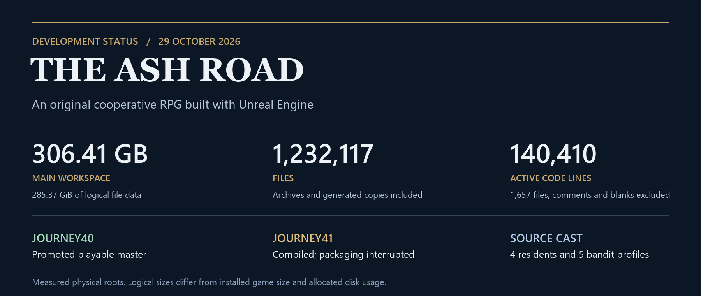

# The Ash Road

System design and development notes for an original cooperative RPG built with Unreal Engine.

<!-- project-status:start -->
## Project status and scale

**[317.46 GB and 1,238,599 files](docs/status/README.md)** in the measured main physical workspace. Archives and generated copies are included; this is not the game's download size.

**141,114 code-only lines** across 1,662 active source files. The [source and documentation inventory](docs/status/README.md#source-code-documentation-and-workflows) also records 713 active Markdown documents and distinguishes project workflows from the separate local skill library.

**Journey42 is promoted; Journey43 remains source work.** Ten resident and five bandit profiles ship in42. Two new identities have saved assembly and seven posed-state checks each; their activation and final equipment/art gates remain open. The [full status report](docs/status/README.md) separates release readiness, source integration, measured storage and key technologies.

[Read the status report](docs/status/README.md) · [View measurement data](docs/status/project-scale.json) · [Open the PNG summary](docs/status/project-status.png)
<!-- project-status:end -->

<!-- outstanding-register:start -->
## Outstanding work

**127 outstanding tracking records**: 47 feature remainders, 62 debug records and 18 change requests. Optional ideas and completed/excluded records are separate.

[Open the numbered work register](docs/backlog/README.md). It groups work by workstream, preserves historical IDs and links duplicates to one owner record. The current character-replacement batch remains first.
<!-- outstanding-register:end -->

<!-- source-history:start -->
## Development history

**1,060 local source commits + 97 documentation commits = 1,157 distinct recorded commits across both histories.** The 612 current-HEAD source commits are included within the 1,060.

[Source ledger and combined statistics](docs/history/README.md) · [Development flow diagram](docs/diagrams/development-history-flow.md). Pull requests: **0**; documentation uses direct selected-file publication to main.
<!-- source-history:end -->

## Systems diagrams

The [dedicated systems-diagrams section](docs/diagrams/README.md) contains the architecture and skills graphs, full-size PNGs, text explanations and editable Mermaid graphs.

| Diagram | PNG | Explanation |
| --- | --- | --- |
| Advanced Custom Game Dev System Design | [Systems architecture](docs/diagrams/ash-road-system-design.png) | [Systems and Unreal technology](docs/diagrams/ash-road-system-design.md) |
| Skills and experience | [Skills relationship graph](docs/diagrams/ash-road-system-design-page-2-skills.png) | [Skills and practical experience](docs/diagrams/ash-road-skills-and-experience.md) |

## Development log

Read the [project log](PROJECT_LOG.md) for development milestones, release status and validation limits. Diagrams are dated snapshots; prepared or isolated work is not automatically part of a playable release.
