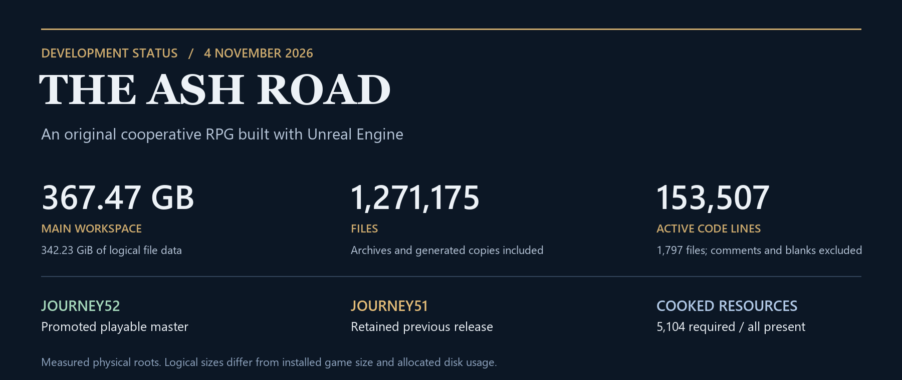

# The Ash Road

System design and development notes for an original cooperative RPG built with Unreal Engine.

<!-- project-status:start -->
## Project status and scale

**Journey46/schema47 is promoted; Journey45 is rollback.** AR-P02 independent equipment visuals is active. Real EOS/WAN acceptance remains open. The status image and scale figures retain their dated 30 October measurement snapshot.

**320.46GB · 1,240,107 files · 142,021 code-only lines across 1,673 active source files.** The 30 October inventory records 721 active Markdown documents and 12 separate local SKILL.md definitions. Workspace figures include archived/generated copies.

[Full status and scale](docs/status/README.md) · [Copy-ready summary](docs/status/teams-summary.txt) · [Exact measurement data](docs/status/project-scale.json)
<!-- project-status:end -->

<!-- outstanding-register:start -->
## Outstanding work

**125 outstanding owner records:** 47 feature families, 61 debug/triage records and 17 changes/gates. Optional ideas and scoped closures are separate. Current priority: AR-P02 independent equipment visuals, following delivered AR-P01 loot/comparison and the approved milestone order.

[Open the numbered work register](docs/backlog/README.md).
<!-- outstanding-register:end -->

<!-- source-history:start -->
## Development history

**At the 30 October audited snapshot: 1,060 local source commits + 102 documentation commits = 1,162 distinct recorded commits across both histories.** The 612 current-HEAD source commits are included within the 1,060.

[Source ledger and combined statistics](docs/history/README.md) · [Development flow diagram](docs/diagrams/development-history-flow.md). Pull requests: **0**; documentation uses direct selected-file publication to main.
<!-- source-history:end -->

## Systems diagrams

The [dedicated systems-diagrams section](docs/diagrams/README.md) contains the architecture and skills graphs, full-size PNGs, text explanations and editable Mermaid graphs.

| Diagram | PNG | Explanation |
| --- | --- | --- |
| Advanced Custom Game Dev System Design | [Systems architecture](docs/diagrams/ash-road-system-design.png) | [Systems and Unreal technology](docs/diagrams/ash-road-system-design.md) |
| Skills and experience | [Skills relationship graph](docs/diagrams/ash-road-system-design-page-2-skills.png) | [Skills and practical experience](docs/diagrams/ash-road-skills-and-experience.md) |

## Development log

Read the [project log](PROJECT_LOG.md) for development milestones, release status and validation limits. Diagrams are dated snapshots; prepared or isolated work is not automatically part of a playable release.

## Owner-recruited second PC

The owner recruited a second PC, **ADAMS-TH**, to help production. The main workstation remains primary: NVIDIA first, local AMD second, then ADAMS-TH for compatible jobs. Independent useful jobs can run concurrently; owner playtesting reserves NVIDIA. ADAMS-TH uses approved portable **Blender 4.1.1**, lightweight CPU work and at most **two threads**. Two hash-verified plate LOD source candidates have returned; native LOD admission and measured runtime savings remain open. Its Radeon HD 7800 Series is separate from the main PC's AMD adapter and has no admitted GPU/inference workload. The existing Linux CPU worker remains an adjunct. The second PC is optional; one controller owns Unreal imports, builds and promotion.

[Compute resources and handoff](docs/compute-resources.md).
