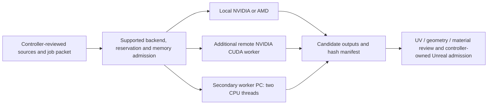

# Production compute resources

Updated 4 November 2026. Generic resource labels preserve the owner's request to omit hostnames.

The main workstation uses **NVIDIA RTX4060Ti/CUDA** and **AMD Radeon/HIP** for compatible independent work. An additional **remote RTX4060 Laptop/CUDA** worker has actual production outputs. The owner-recruited **secondary worker PC** remains a separate optional **Blender4.1.1 CPU** lane, limited to **two threads**; its two returned LOD candidates await native admission. Main/Linux CPUs support preparation and build work; hosted image AI uses provider compute. GPU memory is separate. Prefer local NVIDIA when available; owner reservations take priority, with compatible remote NVIDIA, local AMD and CPU fallback. Check actual capacity before dispatch. One coordinator owns Unreal imports, native builds and promotion.

| Lane | Framework/backend | Actual scope |
| --- | --- | --- |
| Local NVIDIA RTX4060Ti,8GB | CUDA/PyTorch, Blender, Unreal D3D12 | Actual production and native character checks; fresh availability/owner checks required. |
| Local AMD Radeon | HIP/Blender, Unreal D3D12 | Actual asset work and source/packaged views. |
| Additional remote RTX4060 Laptop | Blender5.2.1 LTS, explicit CUDA with CPU rendering disabled | Actual Steel Mace production returned nine hash-verified outputs, including exports, UV layouts and source/detail views. Native admission remains separate. Latest queue waits for a coordinator manifest; prior low RAM held a different item before launch. |
| Owner-recruited secondary worker PC | Portable Blender4.1.1, CPU maximum two threads | Two returned plate LOD candidates; native LOD/game-savings acceptance open. Later bracer/boot audits held on explicit source/identity prerequisites. |
| Main/Linux CPUs | Preparation, export, persistence, build and focused checks | Support lanes; one serialized Unreal/import/build owner. |
| Hosted image AI | Provider compute | Separate from local GPU memory. |

Remote OptiX, remote integrated AMD and the older worker's RadeonHD7800 GPU paths remain unadmitted. Three adapters have actual useful execution evidence; CPU jobs on a machine are not evidence from its GPU. GPU memory is not pooled. No new worker job, benchmark or availability probe was run for this reporting update.

The two original plate source candidates reduced27,960 triangles to18,392 and23,176, with retained borders/UVs and sampled deviation below3mm. These are source candidates, not admitted native LODs or measured runtime savings. Retain approved UV coordinates and corresponding layout images through export/import; retrieval alone does not establish art, fit or game acceptance.

Detailed device/job/connection records remain local. Public summaries include no hostname, address, account or credential. Journey52 is promoted with51 rollback; complete ensembles remain2/24. [Status](status/README.md) · [Diagrams](diagrams/README.md) · [Teams summary](status/teams-summary.txt).
