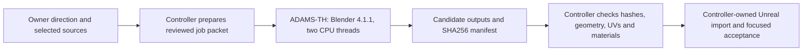

# Production compute resources

Updated 31 October 2026.

The owner recruited a second PC, **ADAMS-TH**, to help production. The main workstation remains primary: NVIDIA first, local AMD second, then ADAMS-TH for compatible jobs. Independent useful jobs can run concurrently; owner playtesting reserves NVIDIA. ADAMS-TH uses approved portable **Blender 4.1.1**, lightweight CPU work and at most **two threads**. Two hash-verified plate LOD source candidates have returned; native LOD admission and measured runtime savings remain open. Its Radeon HD 7800 Series is separate from the main PC's AMD adapter and has no admitted GPU/inference workload. The existing Linux CPU worker remains an adjunct. The second PC is optional; one controller owns Unreal imports, builds and promotion.

| Resource | Frameworks and useful work | Actual scope |
| --- | --- | --- |
| Main NVIDIA RTX 4060 Ti, 8 GB | PyTorch/CUDA inference, Blender CUDA rendering, scheduled Unreal views | Primary compatible accelerator; reserve during owner playtests. |
| Main local AMD Radeon | Unreal D3D12 previews and packaged views; Blender HIP authoring | Verified production and rendering work; select and verify the actual adapter. |
| Owner-recruited ADAMS-TH PC | Blender 4.1.1 and staged PowerShell/SSH jobs; lightweight geometry, LODs, UV layouts and export | Two CPU threads maximum. Two actual LOD candidates retrieved with size/SHA256 validation. Source candidates await native admission. |
| Main and existing Linux CPUs | Preparation, exports, rules/persistence, builds and suitable automation | Adjunct compute; serialized local Unreal/build ownership still applies. |
| Hosted image AI | Provider-managed image generation | Separate compute; no pooled local GPU memory. |

## Worker handoff

Two plate source meshes were reduced from 27,960 triangles to 18,392 and 23,176 triangles. The recorded jobs retained borders/UVs and sampled deviation below 3 mm. These results establish candidate generation and retrieval, not native LOD integration or measured game performance gains.

ADAMS-TH is an optional secondary machine, never a required pipeline dependency. Its older Radeon HD 7800 Series/2 GB has no admitted HIP/render/inference path. Portable Blender 4.1.1 is the approved worker executable; Steam Blender 5.2.3 is CPU-incompatible. Preserve approved UVs and matching layout images through review and import. No automatic game-project import follows job success.

## Notes and evidence scope

[Systems and skills diagrams](diagrams/README.md) · [Project status](status/README.md) · [Copy-ready summary](status/teams-summary.txt)

The controller retains the private operations manual, capability validation and two production-job receipts locally. This public summary excludes connection details and credentials. It adds no playable release; Journey46 remains promoted, Journey45 rollback, and AR-P02 independent equipment visuals remains active.
