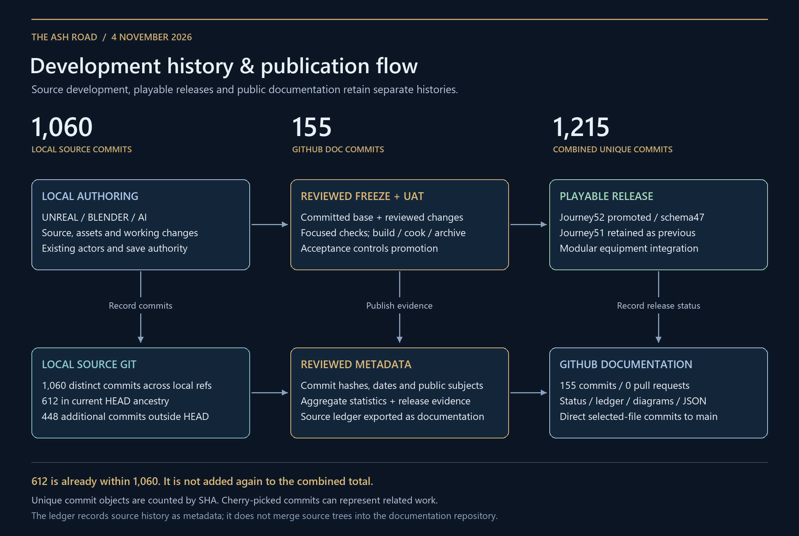
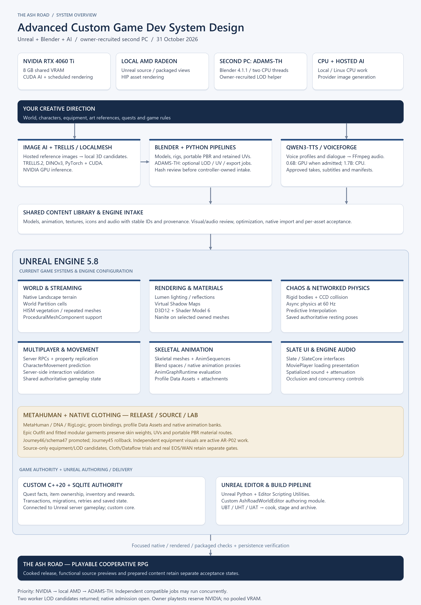
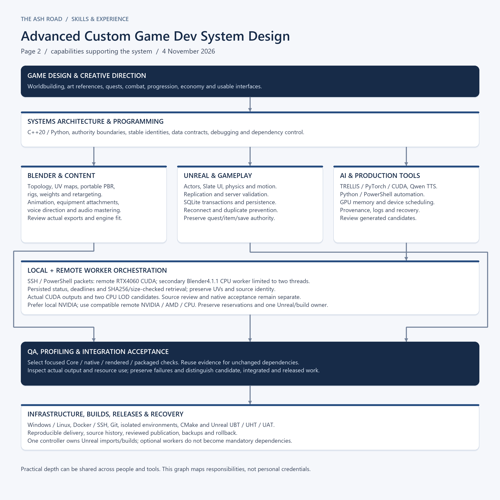

# Systems diagrams

For the latest release state, project size and technology summary, see the [project status page](../status/README.md).

<!-- history-flow:start -->
## Development history and publication flow

[Flow explanation and editable graph](development-history-flow.md) · [PNG](development-history-flow.png) · [SVG](development-history-flow.svg) · [Source ledger and combined statistics](../history/README.md)
<!-- history-flow:end -->

## Advanced Custom Game Dev System Design

The Ash Road's production tools, Unreal technology stack, compute split, and the skills that connect them.

The architecture and skills graphs are updated through **31 October 2026**, including the owner-recruited secondary worker PC. The development-history flow retains its **30 October snapshot**. [Compute roles and limits](../compute-resources.md). Cooked, source and candidate states remain separate.

| Page | View full-size PNG | Text and editable Mermaid graph |
| --- | --- | --- |
| 1 — Systems architecture | [Systems graph](ash-road-system-design.png) | [Architecture explanation](ash-road-system-design.md) |
| 2 — Skills and experience | [Skills graph](ash-road-system-design-page-2-skills.png) | [Skills and practical experience](ash-road-skills-and-experience.md) |

## Page 1 — Systems architecture

## Page 2 — Skills and experience

## Source and scope

[render_system_design.py](render_system_design.py) recreates page 1 with Python, Pillow and the existing Windows Segoe UI fonts. The same renderer also recreates page 2; both have editable Mermaid in their explanations. The repository does not redistribute fonts.

The local evidence paths in the architecture explanation identify the development workspace. Those source/evidence files are not included in this documentation-only publication. The main AMD adapter has verified Unreal source/packaged views and Blender HIP authoring. NVIDIA, local AMD and the owner-recruited secondary worker PC have distinct roles. Clothing simulation trials, source equipment/LOD candidates and broader validation retain separate limits.

## Owner-recruited second PC

The owner recruited a **secondary worker PC** to help production. The main workstation remains primary: NVIDIA first, local AMD second, then secondary worker PC for compatible jobs. Independent useful jobs can run concurrently; owner playtesting reserves NVIDIA. secondary worker PC uses approved portable **Blender 4.1.1**, lightweight CPU work and at most **two threads**. Two hash-verified plate LOD source candidates have returned; native LOD admission and measured runtime savings remain open. Its Radeon HD 7800 Series is separate from the main PC's AMD adapter and has no admitted GPU/inference workload. The existing Linux CPU worker remains an adjunct. The second PC is optional; one controller owns Unreal imports, builds and promotion.

[Compute resources and responsibilities](../compute-resources.md).
