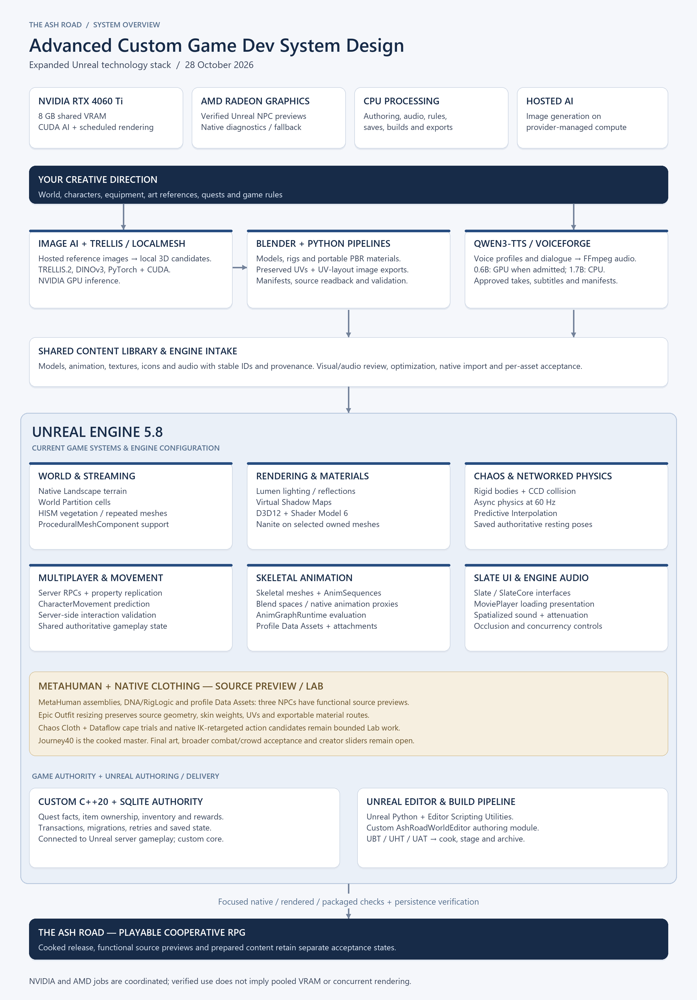
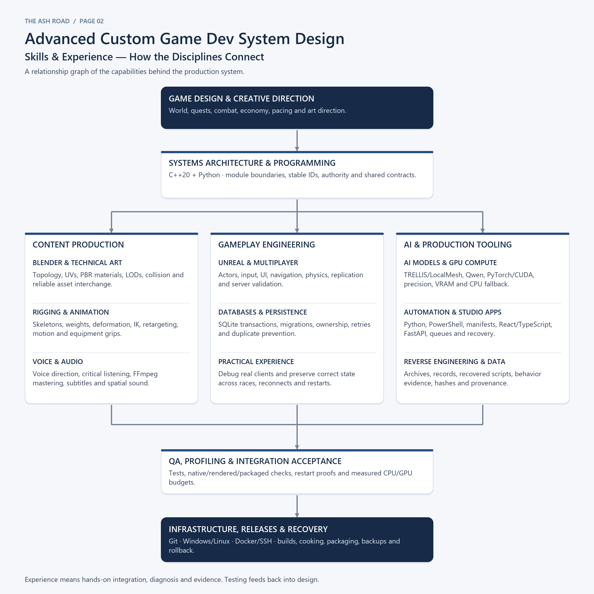

# Systems diagrams

For the latest release state, project size and technology summary, see the [project status page](../status/README.md).

For the latest release state, project size and technology summary, see the [project status page](../status/README.md).

## Advanced Custom Game Dev System Design

The Ash Road's production tools, Unreal technology stack, compute split, and the skills that connect them.

The systems overview is updated through **28 October 2026**. The skills graph remains the 25 October capability map. Cooked releases, functional source previews and Lab experiments have separate acceptance states. See the [project log](../../PROJECT_LOG.md) for development milestones.

| Page | View full-size PNG | Text and editable Mermaid graph |
| --- | --- | --- |
| 1 — Systems architecture | [Systems graph](ash-road-system-design.png) | [Architecture explanation](ash-road-system-design.md) |
| 2 — Skills and experience | [Skills graph](ash-road-system-design-page-2-skills.png) | [Skills and practical experience](ash-road-skills-and-experience.md) |

## Page 1 — Systems architecture



## Page 2 — Skills and experience



## Source and scope

[render_system_design.py](render_system_design.py) recreates page 1 with Python, Pillow and the existing Windows Segoe UI fonts. Page 2 is supplied as a PNG and an editable Mermaid graph in its text document. The repository does not redistribute fonts.

The local evidence paths in the architecture explanation identify the development workspace. Those source/evidence files are not included in this documentation-only publication. AMD now has verified Unreal NPC-preview and native-diagnostic use. Three modern NPC profiles have a functional source preview; clothing simulation, retargeted action candidates, unfinished art and broader validation retain their stated limits.
