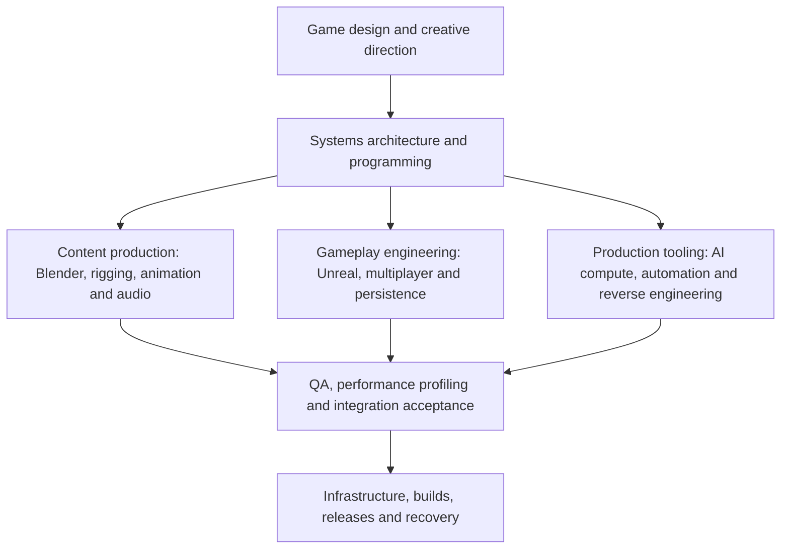

# Advanced Custom Game Dev System Design

## Page 2 — Skills and experience as a relationship graph

Updated 25 October 2026. This describes the capabilities involved in the production system. Practical depth can be shared across people and tools.

The arrows show how responsibilities combine toward delivery. They are not a strict learning order; implementation and testing feed back into design.

## Skills and practical experience

| Discipline | Skills involved | Practical experience needed |
| --- | --- | --- |
| Game design and creative direction | Worldbuilding, quests, combat, progression, economy, pacing, visual references and usable interfaces. | Turn a creative brief into playable content, review it and revise it using playtest evidence. |
| Systems architecture and programming | C++20, Python, modular boundaries, stable identities, authority, data contracts, debugging and dependency control. | Integrate components while keeping clear ownership of state and behavior. |
| Unreal and multiplayer | Actors/components, input, UI, navigation, physics, animation, replication and server-side request validation. | Diagnose actual client/server behavior and connect assets to real game events. |
| Databases and persistence | SQLite, schemas, transactions, migrations, concurrency, retries, ownership and duplicate prevention. | Preserve correct inventory, quest and reward state through races, reconnects, restarts and failures. |
| Blender and technical art | Topology, UVs, normals, PBR materials, scale, axes, pivots, collision, LODs and FBX/GLB interchange. | Prepare art for the engine and validate what survives export, reimport and cooking. |
| Rigging and animation | Skeletons, skin weights, deformation, IK, foot contact, root motion, retargeting, clip timing and equipment attachments. | Diagnose motion and deformation across source tools and engine evaluation. |
| AI models and GPU compute | TRELLIS/LocalMesh and Qwen capabilities, PyTorch/CUDA, precision, staged loading, memory admission and CPU fallback. | Operate pretrained models, coordinate resource use and recognize limits in generated output. |
| Voice and audio production | Voice identity, acting direction, critical listening, FFmpeg editing/mastering, formats, subtitles and spatial sound. | Prepare consistent performances and verify timing, intelligibility and game-event routing. |
| Automation and studio applications | Python, PowerShell, JSON manifests, React/TypeScript, FastAPI, queues, validation, logs and recovery. | Make repeated production jobs traceable, resumable and usable by their operator. |
| Reverse engineering and content data | Archive/plugin/binary formats, Papyrus recovery, behavior reconstruction, conversion, hashes and provenance. | Distinguish recovered evidence from inference, then verify the new implementation. |
| Infrastructure and releases | Windows/Linux, Docker, SSH, Git, isolated environments, CMake, Unreal build/cook/package tools, backups and rollback. | Deliver reproducible builds while protecting working assets, credentials and saved campaigns. |
| QA, profiling and integration | Core tests, fixtures, native/rendered/packaged checks, restart/reconnect coverage and CPU/GPU measurement. | Select meaningful checks, preserve failures and distinguish prepared, integrated, verified and released work. |

The connecting capability is technical and creative judgment: define the intended behavior, choose suitable tools, review their output, and accept a result only when the relevant evidence supports it.

## Image

Matching PNG: `ash-road-system-design-page-2-skills.png`.
