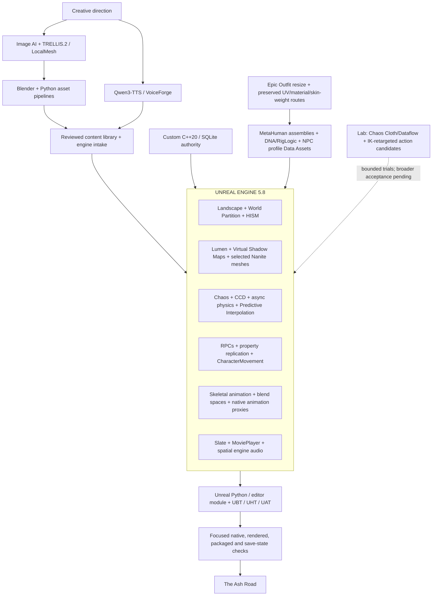

# Advanced Custom Game Dev System Design

Updated 28 October 2026. This overview describes the Unreal runtime, authoring tools and documented bounded usage. Journey40 remains the promoted cooked master. The modern NPC slice is a separate functional source preview, and further content remains in preparation.

## Unreal technology in use

| Area | Technology and role | Scope |
| --- | --- | --- |
| World | Native Landscape, World Partition and HISM repeated-mesh groups; ProceduralMeshComponent enabled/dependent. | Current game/source authoring. World coverage remains bounded. |
| Rendering | Lumen GI/reflections, Virtual Shadow Maps, D3D12/SM6 and Nanite on selected owned assets. | Renderer configuration and documented selected-asset use. Hardware ray tracing is disabled in the inspected config. |
| Physics | Chaos rigid bodies, CCD, asynchronous 60 Hz physics and Predictive Interpolation for networked loose props. | Current physics configuration and loose-object systems; saved rest poses remain under custom authority. |
| Networking | Server RPCs, replicated properties, CharacterMovement prediction and server-side validation. | Existing cooperative runtime. |
| Animation | Skeletal meshes, AnimSequences, blend spaces, AnimGraphRuntime and native animation proxies. | Existing runtime; this is not a claim that gameplay animation is driven by authored Animation Blueprints or Control Rig. |
| Character presentation | MetaHuman assemblies, DNA/RigLogic, bound hair, profile Data Assets and exact-skeleton Idle/Walk clips. | Three NPC profiles have a reviewed functional source preview in Main a06. Existing actor, dialogue, shop, quest and save identities are preserved. This is separate from the cooked master. |
| Native clothing | Epic Outfit source/resize workflow, fit-specific saved garments, full-precision UV checks, skin-weight and material-route validation. | Civilian garments are fitted to actual targets; reusable workwear remains incomplete. Preserved UV coordinates and corresponding layout images are required across art production. |
| Clothing simulation and action motion | Chaos Cloth/Dataflow cape solver trials and native IK-retargeted action candidates. | Bounded CharacterLab work. Actual trials and readback exist; final contact/art, weapon handling, broader combat coverage and runtime rollout remain unapproved. |
| UI/audio | Slate/SlateCore, MoviePlayer, spatialization, attenuation, occlusion and concurrency. | Existing runtime and source presentation paths. |
| Authoring | PythonScriptPlugin, EditorScriptingUtilities and AshRoadWorldEditor. | Editor asset authoring, import and saved-asset verification. |
| Delivery | Unreal Build Tool, Header Tool and Automation Tool; build/cook/stage/archive. | Existing build and release pipeline with separate behavior checks. |

## Modern character and clothing integration

MetaHuman Creator/Character tools, saved DNA, RigLogic and retained plugin Control Rigs support character authoring. The Peltsmith, Sabeth and Elswyth now use actual saved assemblies and fit-specific garments through a shared profile adapter. Main a06 passes the focused all-three AMD world check; reviewed images, alignment, normal conversation and same-actor trading preserve the original authorities. The separate NPC launcher defaults to AMD and uses a private preview campaign. The player presentation and Journey40 cooked master remain unchanged by that source preview.

Epic Outfit resizing, native saved reloads, full-precision UV validation and portable material routes connect source clothing to the assembled characters. Source UVs and matching UV-layout images must be retained; actual coverage and missing maps must be reported. Shared material/fold finish, lighting balance and grip work remain open.

Chaos Cloth/Dataflow cape work has a real solver trial and saved-buffer checks, but final contact and art acceptance remain pending. Native action retargeting and sampled AMD poses provide candidates for bandit work; source actions do not establish finished weapon handling or an active hostile replacement. Runtime creator sliders, crowd performance, broader combat/network acceptance and final art remain separate gates. Mutable remains an evaluation direction rather than an adopted runtime system.

## Compute split

- NVIDIA RTX 4060 Ti, 8 GB: local CUDA inference and scheduled Unreal rendering share the same VRAM. Jobs respect owner availability and explicit resource allocation.
- AMD Radeon integrated graphics: verified for the three-NPC Unreal world preview, native source diagnostics and sampled action-pose rendering; it is the current NPC preview default/fallback route. No AMD CUDA inference or pooled GPU memory is claimed.
- CPU: authoring, exports, audio processing, custom gameplay/persistence, builds and selected render jobs. Qwen 1.7B uses the documented CPU route; 0.6B can use GPU when admitted.
- Hosted image generation: provider-managed compute.

## Custom authority

The engine-independent C++20/SQLite core owns durable quest, inventory, ownership and reward state. It is connected to Unreal gameplay. The inspected project disables the SQLiteCore plugin while using the project's existing SQLite integration; this is not a migration to an Unreal database/save authority.

## Local evidence

These paths identify the development workspace used for this snapshot. They are not a claim that the corresponding source, assets or evidence are included in this documentation-only GitHub publication.

- `unreal/ClawCoop/ClawCoop.uproject`
- `unreal/ClawCoop/Source/ClawCoop/ClawCoop.Build.cs`
- `unreal/ClawCoop/Config/DefaultEngine.ini`
- `unreal/ClawCoop/Source/ClawCoop/ClawAshMarchCellVisibility.cpp`
- `unreal/ClawCoop/Source/ClawCoop/ClawBanditVoices21.cpp`
- `docs/character-foundation.md`
- `docs/character-foundation25.md`
- `docs/characters21.md`
- `docs/common-character-clothing27.md`
- `tools/prepared/npc-roster27/harrowford-delivery-a01/README.md`
- `docs/bandit-character-rollout28.md`
- `docs/barbarian-milestone-20261027.md`
- `docs/physics-foundation.md`
- `docs/briarwatch-preview-delivery.md`
- `CURRENT_WORK.md`

## Outputs

PNG: `ash-road-system-design.png`. Recreate it with `python docs/diagrams/render_system_design.py` using the existing Pillow environment. Page 2 skills artifacts are unchanged.
