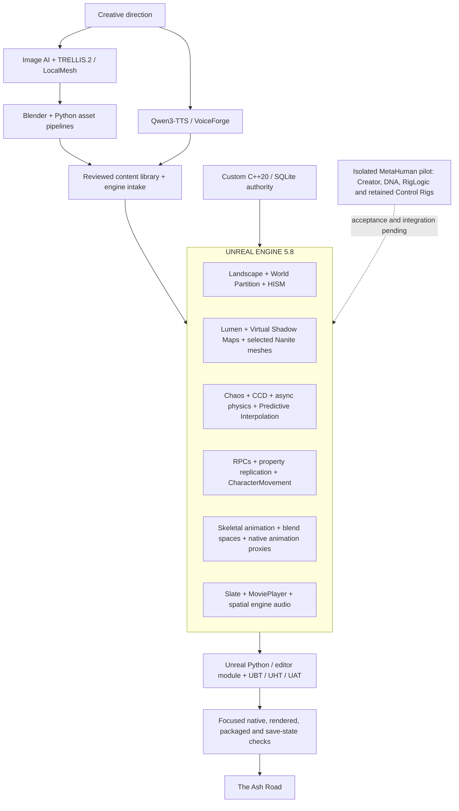

# Advanced Custom Game Dev System Design

Updated 25 October 2026. This overview expands the Unreal runtime and authoring layers. It describes current source/configuration and documented bounded usage; it does not claim universal gameplay or performance acceptance.

## Unreal technology in use

| Area | Technology and role | Scope |
| --- | --- | --- |
| World | Native Landscape, World Partition and HISM repeated-mesh groups; ProceduralMeshComponent enabled/dependent. | Current game/source authoring. World coverage remains bounded. |
| Rendering | Lumen GI/reflections, Virtual Shadow Maps, D3D12/SM6 and Nanite on selected owned assets. | Renderer configuration and documented selected-asset use. Hardware ray tracing is disabled in the inspected config. |
| Physics | Chaos rigid bodies, CCD, asynchronous 60 Hz physics and Predictive Interpolation for networked loose props. | Current physics configuration and loose-object systems; saved rest poses remain under custom authority. |
| Networking | Server RPCs, replicated properties, CharacterMovement prediction and server-side validation. | Existing cooperative runtime. |
| Animation | Skeletal meshes, AnimSequences, blend spaces, AnimGraphRuntime and native animation proxies. | Existing runtime; this is not a claim that gameplay animation is driven by authored Animation Blueprints or Control Rig. |
| UI/audio | Slate/SlateCore, MoviePlayer, spatialization, attenuation, occlusion and concurrency. | Existing runtime and source presentation paths. |
| Authoring | PythonScriptPlugin, EditorScriptingUtilities and AshRoadWorldEditor. | Editor asset authoring, import and saved-asset verification. |
| Delivery | Unreal Build Tool, Header Tool and Automation Tool; build/cook/stage/archive. | Existing build and release pipeline with separate behavior checks. |

## Isolated character pilot

MetaHuman Creator/Character tools, saved DNA, RigLogic and original retained plugin Control Rigs support the human/dwarf studies. Saved body geometry and exact-skeleton motion fixtures have bounded native/readback/render evidence. They are not finished gameplay characters or a runtime character creator. Runtime shape sliders, final art, armor fit and gameplay acceptance remain pending. IK retargeting is under investigation; the legacy scale-only conversion is held. Mutable is an evaluation direction, not an adopted runtime system.

## Compute split

- NVIDIA RTX 4060 Ti, 8 GB: local CUDA inference and Unreal rendering share the same VRAM.
- AMD Radeon integrated graphics: installed; a specific project workload assignment has not been verified.
- CPU: authoring, exports, audio processing, custom gameplay/persistence, builds and selected render jobs. Qwen 1.7B uses the documented CPU route; 0.6B can use GPU when admitted.
- Hosted image generation: provider-managed compute.

## Custom authority

The engine-independent C++20/SQLite core owns durable quest, inventory, ownership and reward state. It is connected to Unreal gameplay. The inspected project disables the SQLiteCore plugin while using the project's existing SQLite integration; this is not a migration to an Unreal database/save authority.

## Local evidence

These paths identify the development workspace used for this snapshot. They are not a claim that the corresponding source, assets or evidence are included in this documentation-only GitHub publication.

- `unreal/ClawCoop/ClawCoop.uproject`
- `unreal/ClawCoop/Source/ClawCoop/ClawCoop.Build.cs`
- `unreal/ClawCoop/Config/DefaultEngine.ini`
- `unreal/ClawCoop/Source/ClawCoop/ClawAshMarchCellVisibility.cpp`
- `unreal/ClawCoop/Source/ClawCoop/ClawBanditVoices21.cpp`
- `docs/character-foundation.md`
- `docs/character-foundation25.md`
- `docs/characters21.md`
- `docs/physics-foundation.md`
- `docs/briarwatch-preview-delivery.md`
- `CURRENT_WORK.md`

## Outputs

PNG: `ash-road-system-design.png`. Recreate it with `python docs/diagrams/render_system_design.py` using the existing Pillow environment. Page 2 skills artifacts are unchanged.
