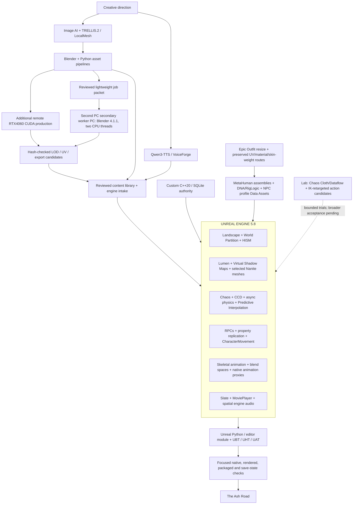

# Advanced Custom Game Dev System Design

Updated4November2026. **Journey52/schema47 promoted;51 rollback.** Complete class ensembles2/24.

## Main frameworks

**UNREAL ENGINE5.8.3** combines Landscape/World Partition/HISM, Lumen/Virtual Shadow Maps/selected Nanite, Chaos/CCD/Predictive Interpolation, replicated gameplay/CharacterMovement, native skeletal animation, Slate/MoviePlayer and engine spatial audio. Custom C++20/SQLite retains durable game authority. MetaHuman/DNA/RigLogic/Outfit support exact character/garment targets; Cloth/Dataflow now has actual runtime solver/routing evidence with visible fit held. UBT/UHT/UAT and Unreal Python support authoring and release.

**BLENDER/PYTHON/POWERSHELL** connect source models, rigs, portable PBR, retained UVs and matching UV-layout images to reviewed imports. **TRELLIS.2/LocalMesh/PyTorch**, hosted image AI and **Qwen3-TTS/VoiceForge/FFmpeg** produce reviewed source candidates and audio. Runtime admission remains explicit.

## Compute split

The main workstation uses **NVIDIA RTX4060Ti/CUDA** and **AMD Radeon/HIP** for compatible independent work. An additional **remote RTX4060 Laptop/CUDA** worker has actual production outputs. The owner-recruited **secondary worker PC** remains a separate optional **Blender4.1.1 CPU** lane, limited to **two threads**; its two returned LOD candidates await native admission. Main/Linux CPUs support preparation and build work; hosted image AI uses provider compute. GPU memory is separate. Prefer local NVIDIA when available; owner reservations take priority, with compatible remote NVIDIA, local AMD and CPU fallback. Check actual capacity before dispatch. One coordinator owns Unreal imports, native builds and promotion.

[Compute roles](../compute-resources.md).

## Current acceptance boundary

A counterpart Rogue hood is integrated, built and checked in source through nine packages; it is outside Journey52. The long-garment route has saved Cloth/Dataflow assets and actual 90-step CPU simulation proof. At checkpoint349, the unintended upper/cuff proxy routing is corrected: **19,119 values restored**, with **9,316 lower values preserved**. Exact cold/two-walk numerical checks pass. Actual image review still holds full fit, art and Main admission because broad underlayer breakthrough remains. Next work addresses garment-derived contact authoring. No Journey53 or additional complete ensemble is claimed.

Journey52 adds68accepted packages; all5104required cooked resources are present. Three launcher argument checks run without games/save access; source appearance proofs are reused. Real EOS/WAN and wider coverage remain open.

[Status and measurements](../status/README.md). Recreate both pages using [render_system_design.py](render_system_design.py); this documentation publication contains no game assets or fonts.
