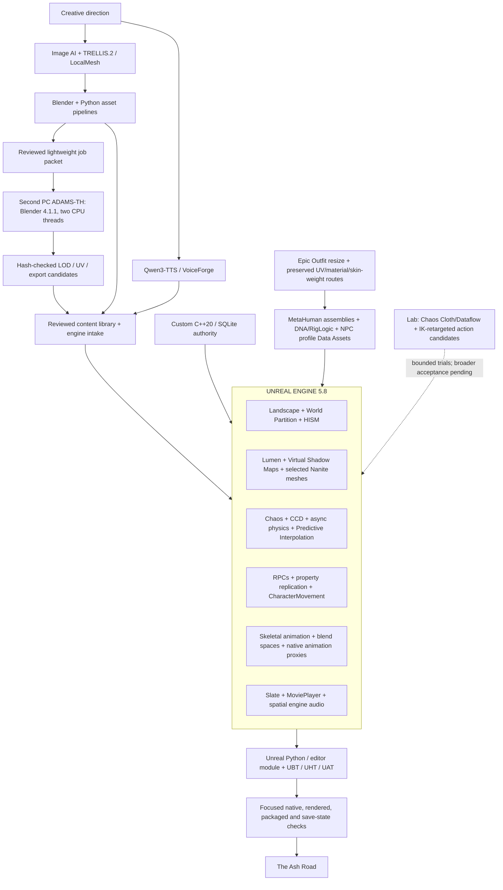

# Advanced Custom Game Dev System Design

Updated 31 October 2026. Journey46/schema47 is promoted; Journey45 is rollback. AR-P02 independent equipment visuals is active. The owner recruited ADAMS-TH as an optional second PC; source candidates and Lab trials retain their separate acceptance states.

## Unreal technology in use

| Area | Technology and role | Scope |
| --- | --- | --- |
| World | Native Landscape, World Partition and HISM repeated-mesh groups; ProceduralMeshComponent enabled/dependent. | Current game/source authoring. World coverage remains bounded. |
| Rendering | Lumen GI/reflections, Virtual Shadow Maps, D3D12/SM6 and Nanite on selected owned assets. | Renderer configuration and documented selected-asset use. Hardware ray tracing is disabled in the inspected config. |
| Physics | Chaos rigid bodies, CCD, asynchronous 60 Hz physics and Predictive Interpolation for networked loose props. | Current physics configuration and loose-object systems; saved rest poses remain under custom authority. |
| Networking | Server RPCs, replicated properties, CharacterMovement prediction and server-side validation. | Existing cooperative runtime. |
| Animation | Skeletal meshes, AnimSequences, blend spaces, AnimGraphRuntime and native animation proxies. | Existing runtime; this is not a claim that gameplay animation is driven by authored Animation Blueprints or Control Rig. |
| Character presentation | MetaHuman assemblies, DNA/RigLogic, bound hair, profile Data Assets and exact-skeleton Idle/Walk clips. | Journey46 retains resident/bandit profile work and includes modern player presentation. Actor, dialogue, shop, quest and save identities remain under existing authority; all-class/ancestry coverage is partial. |
| Native clothing | Epic Outfit source/resize workflow, fit-specific saved garments, full-precision UV checks, skin-weight and material-route validation. | Civilian garments are fitted to actual targets; reusable workwear remains incomplete. Preserved UV coordinates and corresponding layout images are required across art production. |
| Clothing simulation and action motion | Chaos Cloth/Dataflow cape solver trials and native IK-retargeted action candidates. | Bounded CharacterLab work. Actual trials and readback exist; final contact/art, weapon handling, broader combat coverage and runtime rollout remain unapproved. |
| UI/audio | Slate/SlateCore, MoviePlayer, spatialization, attenuation, occlusion and concurrency. | Existing runtime and source presentation paths. |
| Authoring | PythonScriptPlugin, EditorScriptingUtilities and AshRoadWorldEditor. | Editor asset authoring, import and saved-asset verification. |
| Delivery | Unreal Build Tool, Header Tool and Automation Tool; build/cook/stage/archive. | Existing build and release pipeline with separate behavior checks. |

## Modern character and clothing integration

MetaHuman Creator/Character tools, saved DNA, RigLogic and retained plugin Control Rigs support character authoring. The Peltsmith, Sabeth and Elswyth now use actual saved assemblies and fit-specific garments through a shared profile adapter. Main a06 passes the focused all-three AMD world check; reviewed images, alignment, normal conversation and same-actor trading preserve the original authorities. The separate NPC launcher defaults to AMD and uses a private preview campaign. That earlier preview is historical evidence. Journey46 later includes modern player presentation and focused creator/cape/shirt corrections; all-class wardrobe and independent equipment work remain partial.

Epic Outfit resizing, native saved reloads, full-precision UV validation and portable material routes connect source clothing to the assembled characters. Source UVs and matching UV-layout images must be retained; actual coverage and missing maps must be reported. Shared material/fold finish, lighting balance and grip work remain open.

Chaos Cloth/Dataflow cape trials retain separate Lab acceptance. Native retargeting and corrected bandit motion have bounded released proof; modern player motion banks and practical equipment grips also have focused evidence. Independent equipment visuals, full class/ancestry fits and wider motion/network coverage remain partial. Runtime creator sliders, crowd performance, broader combat/network acceptance and final art remain separate gates. Mutable remains an evaluation direction rather than an adopted runtime system.

## Compute split

- NVIDIA RTX 4060 Ti, 8 GB: local CUDA inference and scheduled Unreal rendering share the same VRAM. Jobs respect owner availability and explicit resource allocation.
- Main PC AMD Radeon: verified Unreal source/packaged views and Blender HIP asset rendering; compatible work can run alongside separately assigned NVIDIA jobs. No AMD CUDA inference or pooled GPU memory is claimed.
- CPU: authoring, exports, audio processing, custom gameplay/persistence, builds and selected render jobs. Qwen 1.7B uses the documented CPU route; 0.6B can use GPU when admitted.
- Hosted image generation: provider-managed compute.

The owner recruited a second PC, **ADAMS-TH**, to help production. The main workstation remains primary: NVIDIA first, local AMD second, then ADAMS-TH for compatible jobs. Independent useful jobs can run concurrently; owner playtesting reserves NVIDIA. ADAMS-TH uses approved portable **Blender 4.1.1**, lightweight CPU work and at most **two threads**. Two hash-verified plate LOD source candidates have returned; native LOD admission and measured runtime savings remain open. Its Radeon HD 7800 Series is separate from the main PC's AMD adapter and has no admitted GPU/inference workload. The existing Linux CPU worker remains an adjunct. The second PC is optional; one controller owns Unreal imports, builds and promotion.

[Compute roles and worker handoff](../compute-resources.md).

## Custom authority

The engine-independent C++20/SQLite core owns durable quest, inventory, ownership and reward state. It is connected to Unreal gameplay. The inspected project disables the SQLiteCore plugin while using the project's existing SQLite integration; this is not a migration to an Unreal database/save authority.

## Local evidence

These paths identify the development workspace used for this snapshot. They are not a claim that the corresponding source, assets or evidence are included in this documentation-only GitHub publication.

- `unreal/ClawCoop/ClawCoop.uproject`
- `unreal/ClawCoop/Source/ClawCoop/ClawCoop.Build.cs`
- `unreal/ClawCoop/Config/DefaultEngine.ini`
- `unreal/ClawCoop/Source/ClawCoop/ClawAshMarchCellVisibility.cpp`
- `unreal/ClawCoop/Source/ClawCoop/ClawBanditVoices21.cpp`
- `docs/character-foundation.md`
- `docs/character-foundation25.md`
- `docs/characters21.md`
- `docs/common-character-clothing27.md`
- `tools/prepared/npc-roster27/harrowford-delivery-a01/README.md`
- `docs/bandit-character-rollout28.md`
- `docs/barbarian-milestone-20261027.md`
- `docs/physics-foundation.md`
- `docs/briarwatch-preview-delivery.md`
- `CURRENT_WORK.md`

## Outputs

PNG: `ash-road-system-design.png`. Recreate it with `python docs/diagrams/render_system_design.py` using the existing Pillow environment. The renderer also recreates the updated page 2 skills graph, including remote job orchestration.
