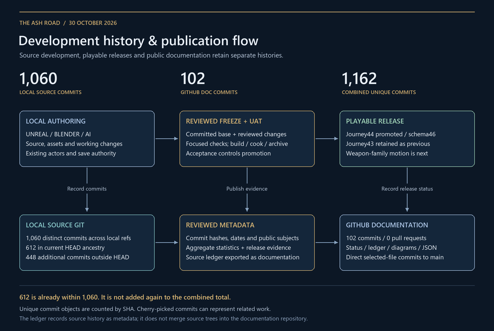
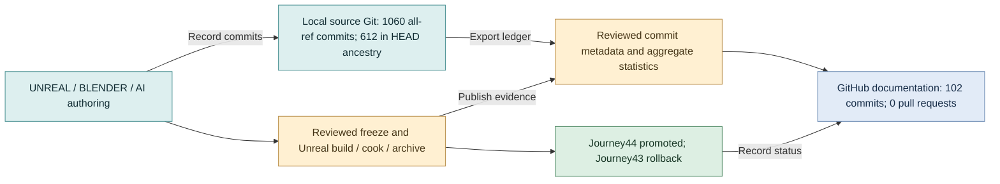

# Development history and publication flow

[History and combined statistics](../history/README.md) · [PNG](development-history-flow.png) · [SVG](development-history-flow.svg) · [Mermaid source](development-history-flow.mmd)

Working source and authoring assets feed both local source commits and reviewed release freezes. A freeze includes its committed base plus reviewed working changes; the current source HEAD alone does not describe every later playable package. Unreal build/cook/archive and focused acceptance determine promotion.

Commit metadata, aggregate statistics and release evidence are published to the separate documentation repository. Its direct commits to main explain the zero pull-request count. Source hashes are recorded in the ledger without implying that their source trees or Git objects are hosted in this repository.

The current HEAD ancestry is a subset of all reachable local source commits. Combined statistics deduplicate the two repository histories by full commit SHA. Unique commit objects are not unique features, accepted releases or independent patches.

[render_history_flow.py](render_history_flow.py) recreates the PNG, SVG and Mermaid from the published history JSON using Python/Pillow and installed Windows Segoe UI fonts. Fonts are not redistributed.
