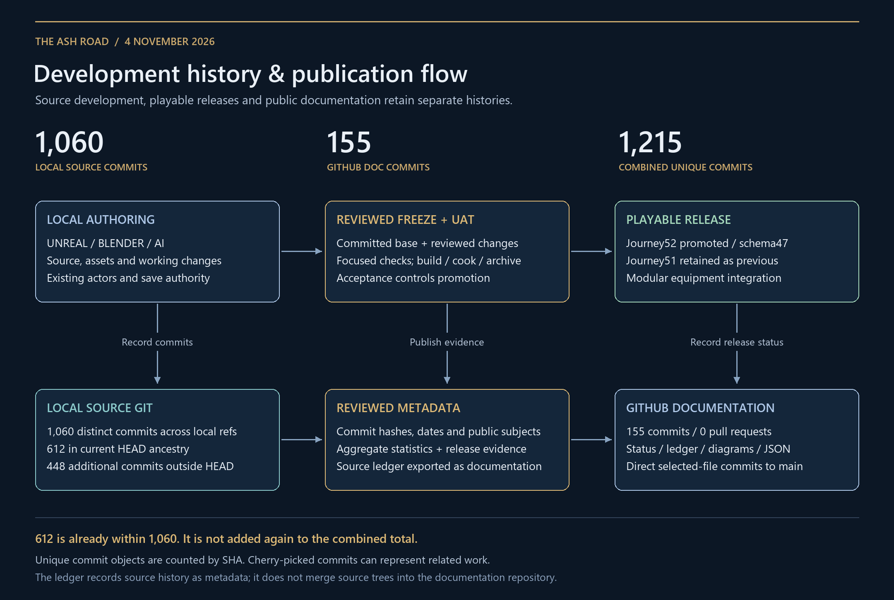

# Development history and combined statistics

**4 November 2026 · Local source Git and GitHub publication history**

[Source commit ledger](source-commit-ledger.md) · [Metadata JSON](source-commits.json) · [Flow PNG](../diagrams/development-history-flow.png) · [Editable flow](../diagrams/development-history-flow.md) · [Project status](../status/README.md)

## Recorded history

| History scope | Commits | Relationship |
| --- | ---: | --- |
| **All reachable local game-source history** | **1,060** | Distinct full SHAs across all local refs; all are also reachable from local branches. |
| Current source HEAD ancestry | **612** | A subset of the 1,060; not added again. HEAD `8051561`. |
| Other source-branch ancestry | **448** | Reachable source commits outside current HEAD ancestry. |
| **GitHub documentation history** | **155** | Separate public repository, including this snapshot's publication commit. |
| Shared source/documentation SHAs at audited base | **0** | Actual intersection checked by full SHA before combining. |
| **Combined unique source + documentation commits** | **1,215** | Union of both histories, including this publication. |
| Pull requests | **0** | Direct selected-file publication to main; open 0, merged 0, closed without merge 0. |

There are **123 local branches** and **130 total local refs**. The source ledger exposes commit hashes, dates, parent links, normalized subjects and HEAD membership. It records source history as documentation; source trees and their Git objects remain in the local source repository.

The earlier **612** figure described current HEAD ancestry. The expanded **1,060** figure includes the parallel source branches. The older embedded project-log appendix had **1,036** source commits; this refresh adds **24**. These are different scopes and snapshots, not conflicting totals.

## How work reaches a release and a status update

Local Unreal/Blender/AI authoring produces working source/assets and local commits. A reviewed release freeze identifies its committed base plus relevant working changes. Focused checks and Unreal build/cook/stage/archive acceptance determine promotion. Journey52 is promoted with Journey51 retained as rollback. Modular class equipment is active; source clothing physics retains visual acceptance gates.

Neutral source commit metadata and release evidence feed the public documentation repository. Selected documentation files are committed directly to main, explaining the zero pull-request count. The public GitHub commit counter counts that repository's actual history; exported ledger rows do not increase its native commit counter.

## Source history by recorded author date

| Author date | Distinct source commits |
| --- | ---: |
| 2026-10-16 | 323 |
| 2026-10-17 | 228 |
| 2026-10-18 | 357 |
| 2026-10-19 | 112 |
| 2026-10-20 | 18 |
| 2026-10-21 | 18 |
| 2026-10-22 | 4 |
| **Total** | **1,060** |

The latest recorded committed source date is 22 October 2026. Later integration, working changes and package freezes are recorded in the development log; they are not invented additional source commits. Author/committer timestamps differ from promotion dates.

## Snapshot and method

Source and documentation graphs were audited at **2026-11-04T16:35:08.703950+00:00**. The hosted baseline was [ee0a360](https://github.com/CA-The-destroyer/G-Ash_Road_ep1/commit/ee0a3600f4934ca161e927841cf619808a14a84d) with **154 commits**. This publication is its one-parent successor, producing **155 documentation commits** and **1,215 combined distinct commit objects**; post-publication verification is retained locally.

Counts use full commit SHA sets, without deduplicating cherry-picked patches or repeated subjects. Commits are not counts of unique tasks, accepted features, developers or shipped releases. Uncommitted work is excluded. Personal contact details and source payloads are outside this metadata export; public subject wording is normalized while commit identifiers and dates remain exact.
