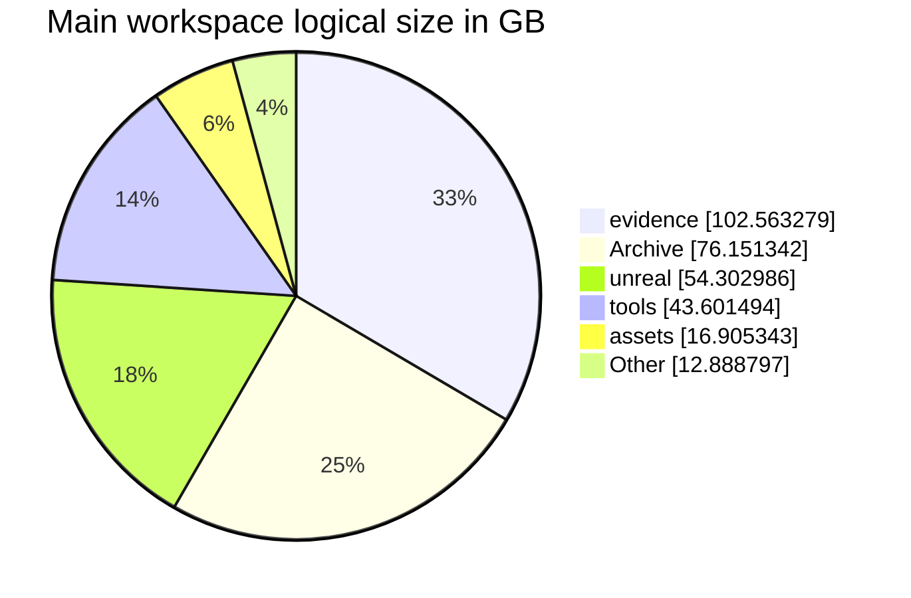

# Project status and scale

<a href="../../PROJECT_LOG.md">Development log</a> · <a href="../diagrams/README.md">Systems diagrams</a> · <a href="project-scale.json">Measurement data</a> · <a href="project-status.png">PNG summary</a>

## At a glance

**Journey40 remains the promoted playable master.** Journey41 code compiled, but packaging was interrupted. New character work has actual source-world evidence; it still awaits an accepted packaged candidate.

| Main physical workspace | Measured result |
| --- | ---: |
| Logical size | **306.41 GB** (285.37 GiB) |
| Regular file entries | **1,232,117** |
| Current Unreal Content | **36.51 GB / 33,547 files** |
| Active code-only lines | **140,410 across 1,657 source files** |
| Active Markdown documents | **705** |
| Scan errors | **0** |
| Reparse points skipped | 4 |

Measurement window: **29 October 2026, 07:58–07:59 Chicago time (UTC−05)**. This is a dated snapshot, not a live monitor.

The main total includes archives, retained packages, evidence and generated output. It does not represent source-code volume, unique authored assets, game download size or the size of this GitHub repository. Archive alone contains **1,090,007 file entries**.

## Source code, documentation and workflows

**140,410 code-only lines across 1,657 active first-party source files**, counted with [cloc 2.10](https://github.com/AlDanial/cloc/releases/tag/v2.10). Comments and blank lines are excluded from this headline. A separate 6,426 comment lines and 4,296 blank lines are recorded in the measurement data.

| Active source area | Counted files | Code-only lines |
| --- | ---: | ---: |
| Runtime and campaign core | 880 | 77,283 |
| Tests | 92 | 7,541 |
| Tooling and build scripts | 685 | 55,586 |
| **Total** | **1,657** | **140,410** |

<strong>Code by language and counting scope</strong>

| Language | Counted files | Code-only lines |
| --- | ---: | ---: |
| C++ | 465 | 66,566 |
| Python | 497 | 43,772 |
| C/C++ Header | 491 | 17,691 |
| PowerShell | 158 | 11,667 |
| DOS Batch | 37 | 321 |
| CMake | 1 | 234 |
| Rust | 2 | 98 |
| C# | 4 | 50 |
| C | 2 | 11 |

The source audit includes runtime/core code, tests, active tooling/build scripts, root launchers and documentation code helpers, including uncommitted source. It excludes prepared experiments, archives, retained copies, vendor/reference dependencies, Unreal-generated build output, companion repositories, assets and configuration/data files. Project-generated source inputs can count; this is not a handwritten-code estimate. cloc's default duplicate-content handling applies. Selected source hashes were unchanged across the count.

| Documentation or reusable workflow | File count | Scope |
| --- | ---: | --- |
| **Active project Markdown** | **705** | Project documents after archive/build/vendor/prepared exclusions. |
| All main-workspace Markdown | **2,744** | `.md` and `.markdown` entries, including retained and prepared copies. |
| **Project `SKILL.md` workflows** | **0** | Reusable workflow definition files inside the game workspace. |
| Local workstation `SKILL.md` workflows | **12** | Separate local skill directory: 7 personal and 5 system definitions. Bundled/plugin libraries are excluded. |

Workflow counts describe actual definition files. They do not represent capability areas, all installed plugin skills, or proof that every definition is used by the game. The code/workflow audit is a separate **29 October, 08:15 Chicago** snapshot; the earlier storage totals retain their original measurement window. [Exact counts and methodology](project-scale.json) are available for inspection.

## Delivery status

| Workstream | Current state | Evidence and remaining gate |
| --- | --- | --- |
| Playable release | **Journey40 promoted** | Journey39 is the retained previous release under the current N / N−1 policy. |
| Journey41 candidate | **Compiled; packaging interrupted** | Last recorded cook checkpoint: **8,532 of 9,207 packages**. No successful archive, candidate verification or promotion receipt exists. This count is not an overall completion percentage. |
| Resident cast | **4 new residents checked in the source world** | Seven saved resident profiles include the earlier three. Twelve new clothing fits pass fresh-process readback. Original actors, shops, quests and saved identities remain authoritative. |
| Melee bandit cast | **5 native profiles checked in the source world** | Four damaged-armor variants and one clothing-only appearance. A focused six-defender camp witness covers saved equipment, defeat/corpse transfer and duplicate prevention. |
| Art and broader coverage | **Further work remains** | Final reference fidelity, unsupported roles, broader multiplayer presentation, crowd cost and road torch transitions retain explicit limits. |
| Physical storage migration | **Cutover complete** | The canonical main workspace, character authoring and 92 linked working copies moved to F:. The migration audit verified 1,359,112 transferred files across its original scope. That historical audit count differs from today's main-root count. |

The current work queue supersedes older statements that Journey41 UAT was still running or that C: remained the physical source location. Recovery must retain the interrupted cook and create the path-correct successor freeze before packaging resumes. Existing valid checks remain reusable.

## Key technology features

| Capability | Main technologies | What they provide |
| --- | --- | --- |
| Cooperative runtime | **Unreal Engine 5.8, C++20, RPCs, replicated properties, CharacterMovement** | Server-authoritative interactions, movement prediction and shared world state. |
| Persistent campaign | **Custom C++ core and SQLite transactions** | Stable identities, inventory/ownership, quest facts, saved rewards, retry handling and duplicate prevention. |
| World and rendering | **Landscape, World Partition, HISM, Lumen, Virtual Shadow Maps, selected Nanite assets, D3D12/SM6** | Streamed terrain, repeated scenery, lighting and material presentation under measured resource limits. |
| Shared object physics | **Chaos, CCD, asynchronous physics, Predictive Interpolation** | Networked loose-object motion with authoritative saved resting poses. |
| Character production | **MetaHuman, DNA/RigLogic, groom bindings, profile Data Assets, Epic Outfit, native animation and retarget tools** | Saved appearances, fitted modular clothing and actor-preserving source-world replacements. Chaos Cloth/Dataflow trials retain separate acceptance states. |
| Asset pipelines | **Blender, Python, PowerShell, JSON manifests, retained UVs and portable PBR maps** | Repeatable preparation, export/import checks, provenance and fit-specific validation. UV-layout images are required deliverables; coverage must be recorded rather than assumed. |
| AI-assisted production | **TRELLIS.2/LocalMesh, DINOv3, PyTorch/CUDA, Qwen3-TTS, VoiceForge, FFmpeg** | Local 3D candidates and voice production, followed by human review and explicit engine integration. |
| UI, audio and delivery | **Slate, MoviePlayer, engine spatial audio, Unreal Python, UBT/UHT/UAT, CMake, Git, Docker/SSH** | Native interfaces, loading presentation, sound routing, editor automation, builds and focused verification. |

### Compute split

- **NVIDIA RTX 4060 Ti, 8 GB:** CUDA inference and scheduled Unreal rendering share its VRAM budget.
- **AMD Radeon Graphics:** verified Unreal NPC previews and native diagnostics provide a separate graphics route.
- **CPU:** source preparation, exports, audio processing, persistence, verification and builds. Larger configured speech models use the recorded CPU route.
- **Hosted image generation:** provider-managed compute. GPU resource assignments remain explicit; memory is not pooled across adapters.

## Where the main workspace size comes from

| Directory group | Logical GB | Files | Share of bytes |
| --- | ---: | ---: | ---: |
| `evidence` | 102.56 | 38,344 | 33.5% |
| `Archive` | 76.15 | 1,090,007 | 24.9% |
| `unreal` | 54.30 | 38,299 | 17.7% |
| `tools` | 43.60 | 44,208 | 14.2% |
| `assets` | 16.91 | 10,655 | 5.5% |
| `releases` | 10.74 | 312 | 3.5% |
| `(root files)` | 0.56 | 331 | 0.2% |
| `build-crafting` | 0.43 | 1,704 | 0.1% |
| Other directories and root files | 1.16 | 8,257 | 0.4% |
| **Total** | **306.41** | **1,232,117** | **100%** |

### Related roots, measured separately

| Scope | Logical GB | Files |
| --- | ---: | ---: |
| Main physical workspace | 306.41 | 1,232,117 |
| Character authoring workspace | 29.29 | 3,810 |
| Linked working copies | 8.26 | 123,197 |
| External Journey41 build output | 11.06 | 44,600 |

These roots are reported separately to avoid presenting companion work, shared dependencies or build copies as unique content. Other asset libraries and AI model caches outside these roots are excluded.

<strong>File-type inventory and measurement method</strong>

| Extension | Entries across the full main workspace |
| --- | ---: |
| `.cpp` | 2,343 |
| `.h` | 1,247 |
| `.hpp` | 2,823 |
| `.py` | 6,116 |
| `.ps1` | 1,076 |
| `.uasset` | 1,120,920 |
| `.umap` | 294 |

Extension totals include archives, generated files, copied sources and retained revisions. They do not measure unique authored assets or original code.

The scan read regular-file metadata from the physical project root and companion roots. It skipped reparse points, did not traverse the compatibility C: junctions and excluded its own report work directory. No payload hashing, builds, asset changes, saves or cleanup operations occurred. File activity during the scan can change subsequent counts. Logical lengths can differ substantially from allocated storage with compression, sparse files and hard links.

GB uses 1,000,000,000 bytes; GiB uses 1,073,741,824 bytes. Exact bytes and the scan window are retained in [the measurement data](project-scale.json).

## Next release gate

Recover the interrupted Journey41 packaging process, preserve its evidence and establish the successor freeze after migration. A completed build/cook/stage/archive and the focused packaged startup/cast checks must precede promotion. No packaging or gameplay work was performed to produce this status report.

## Sources and publication scope

This update derives from the current development queue, the resident/bandit integration report, retention records, engine project/module configuration and the dated filesystem measurement. Local source records include `CURRENT_WORK.md`, `docs/bandit-resident29-progress.md` and `docs/backup-retention.md`; their payloads are not uploaded here. The current queue takes precedence over stale intermediate notes.

This repository publishes status documentation, diagrams and aggregate metadata. Licensed game assets, private campaigns, credentials, model weights and build payloads remain outside the publication.
