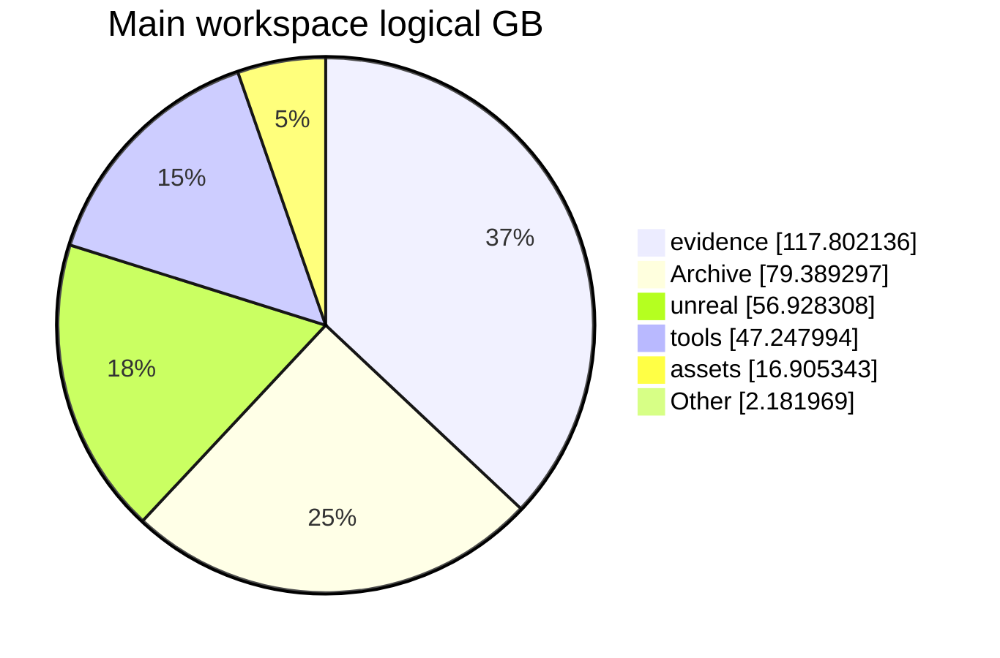

# Project status and scale

<a href="../../PROJECT_LOG.md">Development log</a> · <a href="../diagrams/README.md">Diagrams</a> · <a href="../history/README.md">Source history</a> · <a href="../backlog/README.md">Outstanding work</a> · <a href="project-scale.json">Data</a> · <a href="teams-summary.txt">Copy-ready summary</a>

## At a glance

**Journey44 is built, verified and promoted**, version **0.21.0-preview12-playtest44**, save schema **46**. **Journey43 is rollback.** Native Host/Join, session details and one actual local packaged Host/client pair pass. The inherited catalog contains **10 resident profiles and 6 bandit selectors**. Wider internet reachability, persistent groups and universal character replacement remain open.

| Main workspace metric | Measured result |
| --- | ---: |
| Logical size | **320.46 GB / 298.45 GiB** |
| Regular file entries | **1,240,107** |
| Descendant directories | **920,425** |
| Unreal Content | **38.95 GB / 34,201 files** |
| Active code | **142,021 code-only lines / 1,673 files** |
| Active Markdown | **721 documents** |
| Scan errors / skipped reparse points | **0 / 4** |

Storage/Markdown window: **30 October 2026, 13:42–13:44 Chicago (UTC-05)**. Code/workflow audit: **30 October 2026, 13:45 Chicago (UTC-05)**. These are dated measurements, including uncommitted source where applicable. Workspace size includes archives, evidence and generated copies; it is not game download size, unique authored asset count or allocated disk usage.

Since the previous measured snapshot: **+3.00 GB**, **+1,508 file entries**, **+907 code lines** and **+8 active Markdown documents**. Scope and exclusions remain documented in the data.

## Delivery status

| Workstream | Current state | Evidence and limit |
| --- | --- | --- |
| Playable release | **Journey44 promoted;43 rollback** | Successful build/cook/stage/archive, required cooked closure, package-local Host GUI and one actual good cooked-map client connection. |
| Direct-IP co-op | **Released local Host/Join slice** | Hero name, IPv4/UDP endpoint, failed-Join/retry and session/LAN-endpoint presentation. Both packaged peers report **2 players /2 pawns**; no client campaign database. WAN/router reachability, accounts, relays, join codes and broader group policy remain open. |
| Inherited cast | **10 resident /6 bandit profile selectors shipped** | Five wardrobe recipes share two distinct bearded identities, plus the first additional cloth-only knife profile. Journey43's194 actual game asset additions and practical motion/death/loot proof carry forward unchanged. Profiles are not unique people/body fits or universal replacement. |
| Motion regression | **Practical Journey43 scope closed** | Corrected source frame, target motion and grasp derivatives plus practical dressed Rusty/Iron and original-world checks accepted. Earlier failures stay held. Broader families, physical blade collision and remote feel remain separate work. |
| Next active implementation | **Distinct weapon-family motion** | Reuse existing two-handed sword, heavy axe and blunt sources for actual ready/attack/recovery. Follow with shared interruptible NPC activities, representative villager wardrobe and remaining families. |
| Retention | **44+43 retained** | Exact42 Windows payload retired after preserving60 campaign/config/crash/symbol files,924,116,282bytes. Net6,414,591,507bytes reclaimed; retained payloads rehashed unchanged. |

Journey44 completed all **9,959 cooked packages**, with **4,581 required packages present**. The successful UAT retry took **164s**, including **114.42s cook**. An earlier317-action compile took710.7s before a retained command-budget failure;164s is the successful retry time, not the full cost of every attempt. Seven actual menu/creator/arrival/session views were reviewed. Unchanged cast/source proofs were reused rather than repeating broad battles or campaigns. After a successful client disconnect, reopening the launcher is required before hosting; same-process Join retry is supported.

## Source code, documentation and workflows

**142,021 code-only lines across 1,673 active first-party source files**, measured with [cloc2.10](https://github.com/AlDanial/cloc/releases/tag/v2.10). Comments (**6,518**) and blank lines (**4,320**) are excluded from the headline.

| Source area | Files | Code-only lines |
| --- | ---: | ---: |
| Runtime and campaign core | 889 | 78,309 |
| Tests | 92 | 7,541 |
| Tooling and build scripts | 692 | 56,171 |
| **Total** | **1,673** | **142,021** |

<strong>Language counts and scope</strong>

| Language/category | Files | Code-only lines |
| --- | ---: | ---: |
| C++ | 469 | 67,475 |
| Python | 498 | 43,860 |
| C/C++ Header | 496 | 17,808 |
| PowerShell | 164 | 12,164 |
| DOS Batch | 37 | 321 |
| CMake | 1 | 234 |
| Rust | 2 | 98 |
| C# | 4 | 50 |
| C | 2 | 11 |

Includes active runtime/core, tests, tools/build scripts, root launchers and documentation code helpers, including uncommitted files. Excludes prepared experiments, archives/evidence/releases, vendor/reference dependencies, generated engine/build output, linked worktrees, companion repositories, assets and configuration/data. Project-generated source inputs can count; this is not a handwritten-code estimate. cloc duplicate handling applies; selected source hashes were stable during counting.

| Documentation/workflow | Count | Scope |
| --- | ---: | --- |
| Active project Markdown | **721** | Archive/build/vendor/prepared exclusions applied. |
| Main-workspace Markdown | **2,977** | Includes retained/prepared copies; own report folder excluded. |
| Project SKILL.md definitions | **0** | Reusable workflow files inside the game project. |
| Local workstation SKILL.md definitions | **12** | 7 personal +5 system; bundled/plugin libraries excluded. |

Definition counts do not imply every workflow is loaded or used by the game.

## Numbered outstanding work

**125 outstanding owner records:** **47 feature families**, **61 debug/triage records**, **17 changes/release gates**. There are 45 numbered sub-items inside those owners, not an additional count.

Separate: **18 scoped closures**, **8 optional/long-term records**, **3 monitoring cases**, **1 exclusion**, and **1 acceptance rollup**. Counts are tracking records at different levels, not unique finished features or a completion percentage. [Full register](../backlog/README.md) · [Structured records](../backlog/items.json).

## Source and publication history

| History | Distinct commits |
| --- | ---: |
| All reachable local source refs | **1,060** |
| Current HEAD ancestry, included above | **612** |
| Other source commits outside HEAD | **448** |
| GitHub documentation, including this update | **102** |
| **Combined source/documentation SHA union** | **1,162** |
| Pull requests | **0** |

Full-SHA overlap was checked before combining. The source ledger is exported metadata; it does not import source Git objects. Direct selected-file documentation commits explain the zero PR count. [Ledger and methodology](../history/README.md) · [Updated flow](../diagrams/development-history-flow.md).

## Key technology features

| Capability | Main technologies | What they provide |
| --- | --- | --- |
| Cooperative runtime | **Unreal Engine 5.8, C++20, RPCs/replication, CharacterMovement, listen server, NetDriver, ClientTravel** | Server-authoritative interactions and shared state, with released native direct-IP Host/Join and session details; broader internet/group coverage remains separate. |
| Persistent campaign | **Custom C++ core and SQLite transactions** | Stable identities, inventory/ownership, quest facts, saved rewards, retry handling and duplicate prevention. |
| World and rendering | **Landscape, World Partition, HISM, Lumen, Virtual Shadow Maps, selected Nanite assets, D3D12/SM6** | Streamed terrain, repeated scenery, lighting and material presentation under measured resource limits. |
| Shared object physics | **Chaos, CCD, asynchronous physics, Predictive Interpolation** | Networked loose-object motion with authoritative saved resting poses. |
| Character production | **MetaHuman, DNA/RigLogic, groom bindings, profile Data Assets, Epic Outfit, native animation and retarget tools** | Saved appearances, fitted modular clothing and actor-preserving source-world replacements. Chaos Cloth/Dataflow trials retain separate acceptance states. |
| Asset pipelines | **Blender, Python, PowerShell, JSON manifests, retained UVs and portable PBR maps** | Repeatable preparation, export/import checks, provenance and fit-specific validation. UV-layout images are required deliverables; coverage must be recorded rather than assumed. |
| AI-assisted production | **TRELLIS.2/LocalMesh, DINOv3, PyTorch/CUDA, Qwen3-TTS, VoiceForge, FFmpeg** | Local 3D candidates and voice production, followed by human review and explicit engine integration. |
| UI, audio and delivery | **Slate, MoviePlayer, engine spatial audio, Unreal Python, UBT/UHT/UAT, CMake, Git, Docker/SSH** | Native interfaces, loading presentation, sound routing, editor automation, builds and focused verification. |

### Compute split

- **NVIDIA RTX4060Ti,8GB:** CUDA inference and scheduled Unreal rendering share its budget. Reserve it during owner playtests.
- **AMD Radeon Graphics:** actual Unreal D3D12/vendor1002 source and packaged co-op views are verified. Prepared authoring also has AMD HIP render evidence; preparation is separate from native/runtime admission.
- **CPU:** source preparation, exports, builds, persistence, audio work and verification. Hosted image generation uses provider compute. Memory is not pooled across adapters; one coordinator owns native/build work.

## Where workspace size comes from

| Directory group | GB | Files | Share |
| --- | ---: | ---: | ---: |
| `evidence` | 117.80 | 41,746 | 36.8% |
| `Archive` | 79.39 | 1,090,240 | 24.8% |
| `unreal` | 56.93 | 39,704 | 17.8% |
| `tools` | 47.25 | 47,354 | 14.7% |
| `assets` | 16.91 | 10,655 | 5.3% |
| `(root files)` | 0.56 | 337 | 0.2% |
| `build-crafting` | 0.43 | 1,704 | 0.1% |
| `build-economy` | 0.35 | 1,161 | 0.1% |
| Other directories/root files | 0.84 | 7,206 | 0.3% |
| **Total** | **320.46** | **1,240,107** | **100%** |

### Related roots, separately measured

| Scope | GB | Files |
| --- | ---: | ---: |
| Main physical workspace | 320.46 | 1,240,107 |
| CharacterLab authoring workspace | 32.98 | 4,777 |
| Linked working copies | 8.26 | 123,197 |
| External build workspace: retained44/43 plus historical evidence/intermediates/caches | 83.55 | 210,075 |

Roots are separate scopes and can include copies/hardlinks of shared content; do not sum them as unique authored assets. Other asset libraries and model caches outside these roots are excluded. Logical lengths can differ from allocated storage under compression, sparse files and hardlinks. Live file activity can change later counts. All scan roots had zero errors and reparse points were skipped.

## Next delivery priorities

1. Actual two-handed sword, heavy axe and blunt ready/attack/recovery using the corrected existing animation path.
2. Shared interruptible cooking/fire/bench/household activities through existing schedules.
3. Representative reference-led villager wardrobe, then remaining character families in useful bounded batches.

Favor visible player benefit and reuse. Record small cosmetic gaps; keep checks for crashes, missing bodies, broken motion and real integration. This reporting update performs no game build, runtime, asset, save or cleanup operation.

## Sources and snapshot scope

Current release/priority comes from `CURRENT_WORK.md`, `docs/coop44-delivery.md`, `docs/cast43-delivery.md`, `docs/priority-roi44.md`, the actual44 promotion receipt and the current numbered register. Storage and source metrics come from the new separate scans. Their private evidence payloads remain local. [Exact public aggregates](project-scale.json) and the [copy-ready summary](teams-summary.txt) accompany this page.
