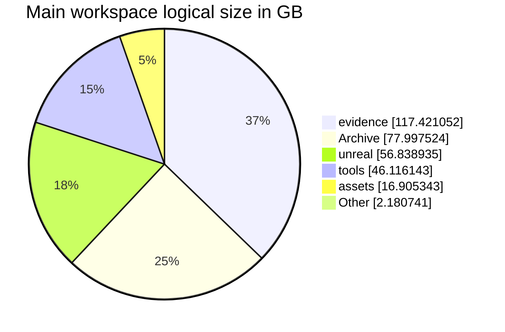

# Project status and scale

<a href="../../PROJECT_LOG.md">Development log</a> · <a href="../diagrams/README.md">Systems diagrams</a> · <a href="project-scale.json">Measurement data</a> · <a href="project-status.png">PNG summary</a>

## At a glance

**Journey42 is the promoted playable release**, version **0.21.0-preview12-playtest42**, save schema **46**. It ships ten resident and five bandit profiles. Journey43 is ongoing source work with explicit art, equipment and in-world admission gates; no Journey43 package or promotion is claimed.

| Main physical workspace | Measured result |
| --- | ---: |
| Logical size | **317.46 GB** (295.66 GiB) |
| Regular file entries | **1,238,599** |
| Current Unreal Content | **38.93 GB / 34,185 files** |
| Active code-only lines | **141,114 across 1,662 source files** |
| Active Markdown documents | **713** |
| Scan errors | **0** |
| Reparse points skipped | 4 |

Measurement window: **30 October 2026, 07:39–07:41 Chicago time (UTC−05)**. This is a dated snapshot, not a live monitor.

The main total includes archives, retained packages, evidence and generated output. It does not represent source-code volume, unique authored assets, game download size or the size of this GitHub repository. Archive alone contains **1,090,141 file entries**.

## Source code, documentation and workflows

**141,114 code-only lines across 1,662 active first-party source files**, counted with [cloc 2.10](https://github.com/AlDanial/cloc/releases/tag/v2.10). Comments and blank lines are excluded from this headline. A separate 6,466 comment lines and 4,301 blank lines are recorded in the measurement data.

| Active source area | Counted files | Code-only lines |
| --- | ---: | ---: |
| Runtime and campaign core | 883 | 77,841 |
| Tests | 92 | 7,541 |
| Tooling and build scripts | 687 | 55,732 |
| **Total** | **1,662** | **141,114** |

<strong>Code by language and counting scope</strong>

| Language | Counted files | Code-only lines |
| --- | ---: | ---: |
| C++ | 466 | 67,051 |
| Python | 497 | 43,772 |
| C/C++ Header | 493 | 17,764 |
| PowerShell | 160 | 11,813 |
| DOS Batch | 37 | 321 |
| CMake | 1 | 234 |
| Rust | 2 | 98 |
| C# | 4 | 50 |
| C | 2 | 11 |

The source audit includes runtime/core code, tests, active tooling/build scripts, root launchers and documentation code helpers, including uncommitted source. It excludes prepared experiments, archives, retained copies, vendor/reference dependencies, Unreal-generated build output, companion repositories, assets and configuration/data files. Project-generated source inputs can count; this is not a handwritten-code estimate. cloc's default duplicate-content handling applies. Selected source hashes were unchanged across the count.

| Documentation or reusable workflow | File count | Scope |
| --- | ---: | --- |
| **Active project Markdown** | **713** | Project documents after archive/build/vendor/prepared exclusions. |
| Main-workspace Markdown snapshot | **2,866** | `.md` and `.markdown` entries, including retained/prepared copies; own report folder excluded. Collected during the storage scan. |
| **Project `SKILL.md` workflows** | **0** | Reusable workflow definition files inside the game workspace. |
| Local workstation `SKILL.md` workflows | **12** | Separate local skill directory: 7 personal and 5 system definitions. Bundled/plugin libraries are excluded. |

Workflow counts describe actual definition files. They do not represent capability areas, all installed plugin skills, or proof that every definition is used by the game. The code/workflow audit is a separate **30 October 2026, 07:42 Chicago time (UTC-05)** snapshot; storage totals retain the separate measurement window above. [Exact counts and methodology](project-scale.json) are available for inspection.

<!-- outstanding-navigation:start -->
## Numbered outstanding work

**127 outstanding tracking records**: 47 feature remainders, 62 debug records and 18 change requests. Optional ideas and completed/excluded records are separate.

[Browse the full register](../backlog/README.md) or [inspect its JSON](../backlog/items.json). Historical feature IDs and debug cases are reconciled against newer release records. This tracking update does not change the active implementation order.
<!-- outstanding-navigation:end -->

<!-- source-history:start -->
## Source and publication history

| Commit scope | Count |
| --- | ---: |
| All reachable local source commits | **1,060** |
| Current HEAD ancestry, included above | **612** |
| Additional source commits outside HEAD | **448** |
| GitHub documentation commits, including this publication | **97** |
| **Combined unique source + documentation SHAs** | **1,157** |
| Pull requests | **0** |

[History, scope and full source ledger](../history/README.md) · [Flow diagram](../diagrams/development-history-flow.md). These distinguish the source Git graph from the public documentation graph; exported ledger rows do not change GitHub's native commit counter.
<!-- source-history:end -->

## Delivery status

| Workstream | Current state | Evidence and remaining gate |
| --- | --- | --- |
| Playable release | **Journey42 promoted** | Version 0.21.0-preview12-playtest42 / schema46. Ten resident and five bandit profiles ship; Journey41 is retained under the N / N−1 policy. |
| Journey43 candidate | **Source work; no package** | Source changes compile, but no Journey43 package, catalog promotion or owner-save edit is recorded. |
| Two new bandit identities | **Saved assembly and 7 posed states per identity checked** | Native AMD previews verify posed head follow. An add-only copy brings 178 new source files / 604,930,577 bytes into Main as disabled assets; two existing shared files are byte-identical. Activation and final wardrobe admission remain open. |
| Equipment enrollment | **Source integration compiled** | Canonical sparse-equipment enrollment preserves existing saved assignments and rolls. Previously unenrolled eligible actors can gain legitimate equipment/protection; this transition can affect equipment stats. Unsupported visuals keep complete legacy appearances. |
| Sword motion and grip | **Correction source-verified; dressed review open** | The corrected source frame, fresh two-target retarget and all40-phase signed RAW/COMPRESSED checks pass. Both targets have fresh right15-only grasp derivatives with author/cold proof. Reuse those candidates for focused dressed Rusty/Iron grip/contact and original-actor admission; earlier failed clips stay held. |
| Additional melee profile | **Corrected motion/grasp source-verified** | Seven-state, corrected target motion and right15 grasp author/cold checks pass. Actual dressed/grip/world admission remains open; prepared slot-specific evidence is not an installed witness. |
| Villager wardrobe | **Bounded prototype fitting accepted** | The source vest retains weights, UVs and export. Reference costume art and native Outfit admission remain unfinished. |
| Broader coverage | **Partial** | Guards, named/rescue actors, other ancestries, creatures, player profiles and fallback adapters retain separate work. Two new identities do not establish universal cast replacement. |

Journey42's build/cook/stage/archive completed in **20m37s**, and all **4,262 required cooked packages** were present. The packaged catalog and focused original-camp check passed. These checks establish the bounded release; broader visual/multiplayer coverage remains open.

Current-source results and shipped Journey42 coverage are distinct. Historical Journey40/Journey41 interruption notes remain in the development log; they no longer describe the current promoted release.

## Key technology features

| Capability | Main technologies | What they provide |
| --- | --- | --- |
| Cooperative runtime | **Unreal Engine 5.8, C++20, RPCs, replicated properties, CharacterMovement** | Server-authoritative interactions, movement prediction and shared world state. |
| Persistent campaign | **Custom C++ core and SQLite transactions** | Stable identities, inventory/ownership, quest facts, saved rewards, retry handling and duplicate prevention. |
| World and rendering | **Landscape, World Partition, HISM, Lumen, Virtual Shadow Maps, selected Nanite assets, D3D12/SM6** | Streamed terrain, repeated scenery, lighting and material presentation under measured resource limits. |
| Shared object physics | **Chaos, CCD, asynchronous physics, Predictive Interpolation** | Networked loose-object motion with authoritative saved resting poses. |
| Character production | **MetaHuman, DNA/RigLogic, groom bindings, profile Data Assets, Epic Outfit, native animation and retarget tools** | Saved appearances, fitted modular clothing and actor-preserving source-world replacements. Chaos Cloth/Dataflow trials retain separate acceptance states. |
| Asset pipelines | **Blender, Python, PowerShell, JSON manifests, retained UVs and portable PBR maps** | Repeatable preparation, export/import checks, provenance and fit-specific validation. UV-layout images are required deliverables; coverage must be recorded rather than assumed. |
| AI-assisted production | **TRELLIS.2/LocalMesh, DINOv3, PyTorch/CUDA, Qwen3-TTS, VoiceForge, FFmpeg** | Local 3D candidates and voice production, followed by human review and explicit engine integration. |
| UI, audio and delivery | **Slate, MoviePlayer, engine spatial audio, Unreal Python, UBT/UHT/UAT, CMake, Git, Docker/SSH** | Native interfaces, loading presentation, sound routing, editor automation, builds and focused verification. |

### Compute split

- **NVIDIA RTX 4060 Ti, 8 GB:** CUDA inference and scheduled Unreal rendering share its VRAM budget. The owner explicitly released it after the 30 October reservation; both GPUs and CPU are available under coordinator scheduling. Reserve NVIDIA again during owner playtests.
- **AMD Radeon Graphics:** current native cast previews actually use **D3D12 adapter 1 / vendor 1002**. Use independent compatible jobs on both GPUs when available. During owner playtests, use AMD or CPU and never fall back automatically to NVIDIA. AMD HIP was also used for prepared clothing-source renders documented with Journey42; those renders establish source candidates, with native fit and runtime admission tracked separately. The shared Unreal/build slot remains coordinator-owned.
- **CPU:** source preparation, exports, audio processing, persistence, verification and builds. Larger configured speech models use the recorded CPU route.
- **Hosted image generation:** provider-managed compute. GPU resource assignments remain explicit; memory is not pooled across adapters.

## Where the main workspace size comes from

| Directory group | Logical GB | Files | Share of bytes |
| --- | ---: | ---: | ---: |
| `evidence` | 117.42 | 41,348 | 37.0% |
| `Archive` | 78.00 | 1,090,141 | 24.6% |
| `unreal` | 56.84 | 39,649 | 17.9% |
| `tools` | 46.12 | 46,416 | 14.5% |
| `assets` | 16.91 | 10,655 | 5.3% |
| `(root files)` | 0.56 | 333 | 0.2% |
| `build-crafting` | 0.43 | 1,704 | 0.1% |
| `build-economy` | 0.35 | 1,161 | 0.1% |
| Other directories and root files | 0.84 | 7,192 | 0.3% |
| **Total** | **317.46** | **1,238,599** | **100%** |

### Related roots, measured separately

| Scope | Logical GB | Files |
| --- | ---: | ---: |
| Main physical workspace | 317.46 | 1,238,599 |
| Character authoring workspace | 32.98 | 4,763 |
| Linked working copies | 8.26 | 123,197 |
| External build workspace, including Journey41 and Journey42 | 51.62 | 95,076 |

These roots are reported separately to avoid presenting companion work, shared dependencies or build copies as unique content. Other asset libraries and AI model caches outside these roots are excluded. The external-build scope now covers the parent builds directory, including both retained releases and intermediate output; the prior snapshot measured Journey41 only.

<strong>File-type inventory and measurement method</strong>

| Extension | Entries across the full main workspace |
| --- | ---: |
| `.cpp` | 2,392 |
| `.h` | 1,259 |
| `.hpp` | 2,824 |
| `.py` | 6,401 |
| `.ps1` | 1,091 |
| `.uasset` | 1,121,564 |
| `.umap` | 294 |

Extension totals include archives, generated files, copied sources and retained revisions. They do not measure unique authored assets or original code.

The scan read regular-file metadata from the physical project root and companion roots. It skipped reparse points, did not traverse the compatibility C: junctions and excluded its own report work directory. No payload hashing, builds, asset changes, saves or cleanup operations occurred. File activity during the scan can change subsequent counts. Logical lengths can differ substantially from allocated storage with compression, sparse files and hard links.

GB uses 1,000,000,000 bytes; GiB uses 1,073,741,824 bytes. Exact bytes and the scan window are retained in [the measurement data](project-scale.json).

## Next release gate

Reuse the corrected source frame and cold-verified grasp derivatives, then finish focused dressed Rusty/Iron motion, grip and contact admission and activate the two checked identities through the existing catalog operators, admit the additional fitted melee profile and continue the reference-led vest through the existing Outfit path. Batch coherent source results into Journey43; after UAT, run only precise checks for changed cooked behavior. Journey42 remains playable until a successor is accepted. Owner direction30 October: prioritize useful characters in normal gameplay and a playable build. Accept reasonable playtest-quality grip/surface results, record cosmetic gaps and move on. Retain checks for obvious broken motion, missing bodies, crashes and actual integration; avoid broad repeat verification for minor refinements. No build, gameplay or saved-state operation was performed for this report.

## Sources and publication scope

This update derives from the current development queue, the latest release log, cast43 handoffs, retention records, engine project/module configuration and the dated filesystem measurement. Local source records include `CURRENT_WORK.md`, `PROJECT_LOG.md` and `docs/backup-retention.md`; their payloads are not uploaded here. The current queue takes precedence over stale intermediate notes.

This repository publishes status documentation, diagrams and aggregate metadata. Licensed game assets, private campaigns, credentials, model weights and build payloads remain outside the publication.
