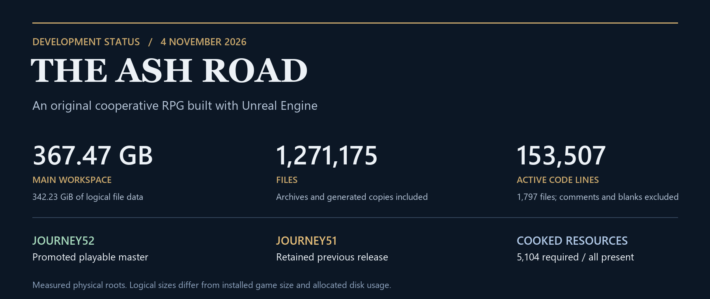

# Project status and scale

**4 November 2026 — Journey52 promoted; Journey51 rollback.** Modular Human class equipment is active. Complete class ensembles remain **2/24**.

[Copy-ready Teams summary](teams-summary.txt) · [Systems and skills diagrams](../diagrams/README.md) · [Compute roles](../compute-resources.md) · [History](../history/README.md) · [Data](project-scale.json)

## Current delivery and source work

Journey52 (`0.21.0-preview12-playtest52`, schema47) adds **68 accepted packages** for selected default-profile class headwear and Cleric appearance. **UAT361.68s**, all **5,104 required cooked resources** and **three intercepted launcher checks** pass. The launcher checks spawned zero games and opened no owner campaign; accepted source appearance/movement proofs were reused. Wider packaged campaign replay, EOS/WAN and universal character/art coverage remain outside that proof.

A counterpart Rogue hood is integrated, built and checked in source through nine packages; it is outside Journey52. The long-garment route has saved Cloth/Dataflow assets and actual 90-step CPU simulation proof. At checkpoint349, the unintended upper/cuff proxy routing is corrected: **19,119 values restored**, with **9,316 lower values preserved**. Exact cold/two-walk numerical checks pass. Actual image review still holds full fit, art and Main admission because broad underlayer breakthrough remains. Next work addresses garment-derived contact authoring. No Journey53 or additional complete ensemble is claimed.

Journey51 remains rollback. Superseded50 is preserved pending its separate state-preservation/retention step; this refresh performs no cleanup.

## Fresh measured scale

| Main physical workspace | Measured result |
| --- | ---: |
| Logical size | **367.47 GB / 342.23 GiB** |
| Regular-file entries | **1,271,175** |
| Descendant directories | **926,324** |
| Unreal Content | **40.63 GB / 34,918 files** |
| Active first-party code | **153,507 code-only lines / 1,797 files** |
| Active Markdown | **798** |
| All main-workspace Markdown | **4,355** |
| Project reusable SKILL.md files | **0** |
| Separate local reusable SKILL.md definitions | **12** |
| Scan errors / main skipped reparse points | **0 / 4** |

Storage/Markdown: **2026-11-04T10:29:16.474596-06:00 to 2026-11-04T10:32:20.100312-06:00**, America/Chicago (UTC-06). Code/workflows: **2026-11-04T16:35:30.633434+00:00**. The current build root was measured separately at 2026-11-04T10:30:46.707448-06:00 to 2026-11-04T10:31:11.174010-06:00.

Change versus the prior published 30 October measurement: **+47.01 GB · +31,068 files · +11,486 code lines · +77 active Markdown**. Workspace totals include archives, evidence and generated copies; they are logical storage, not game download size or unique authored content. Remote machine storage/source and other model libraries are excluded. Live work can change subsequent counts.

## Code, Markdown and workflows

| First-party source area | Files | Code-only lines |
| --- | ---: | ---: |
| Runtime and campaign core | 960 | 85,289 |
| Tests | 95 | 8,068 |
| Tooling and build scripts | 742 | 60,150 |
| **Total** | **1,797** | **153,507** |

Comments (7,299) and blank lines (4,521) are excluded from the headline. [cloc2.10](https://github.com/AlDanial/cloc/releases/tag/v2.10) uses default duplicate-content suppression and the established curated active runtime/core/tests/tools/docs-helper/root-launcher scope, including uncommitted files. Archives, prepared experiments, evidence/releases, vendor/reference dependencies, generated engine/build output, companion roots and configuration/assets are excluded. Source hashes were stable during the count. Project-generated source inputs can count; this is not a handwritten-code estimate.

| Language | Files | Code-only lines |
| --- | ---: | ---: |
| C++ | 514 | 72,692 |
| Python | 506 | 44,453 |
| C/C++ Header | 525 | 20,098 |
| PowerShell | 206 | 15,541 |
| DOS Batch | 37 | 321 |
| CMake | 1 | 243 |
| Rust | 2 | 98 |
| C# | 4 | 50 |
| C | 2 | 11 |

Markdown active exclusions match the documented archive/build/vendor/prepared scope. Reusable SKILL.md counts are file definitions: **7 personal + 5 system**, outside the game project; bundled/plugin skill libraries are excluded. They do not imply every skill was used.

## Outstanding work register

The last numbered-register snapshot (2026-10-31T18:33:51.966094+00:00) records **125 outstanding owners: 47 feature families, 61 debug/triage records and 17 changes/gates**. Separate: 18 scoped closures, 8 optional/long-term records, 3 monitoring cases. Its 45 numbered sub-items belong inside those owner totals. Later intakes have not been re-audited by this metrics refresh; these are tracking records, not a unique-task count or completion percentage. [Recorded register](../backlog/README.md).

## Local Git and GitHub

| Source/publication history | Distinct commits |
| --- | ---: |
| All reachable local source refs | **1,060** |
| Current HEAD ancestry, included above | **612** |
| Outside HEAD ancestry | **448** |
| GitHub documentation, including this publication | **155** |
| Combined SHA union | **1,215** |
| Pull requests | **0** |

Full-SHA source/documentation overlap is **0**. The 612 HEAD commits are already within 1,060. The source ledger exports metadata only; source Git objects/assets are not uploaded. Direct selected-file publication to main explains the PR count. Later working changes and release freezes do not invent committed-source history. [Ledger and method](../history/README.md).

## Frameworks and compute

| Capability | Main frameworks | Current boundary |
| --- | --- | --- |
| Game/runtime | **Unreal Engine5.8.3, C++20**, Actors, AI/navigation, RPC/property replication and CharacterMovement | Existing cooperative server authority and native presentation. Real EOS/WAN remains unverified. |
| Persistent campaign | **Custom C++ / SQLite** transactions and stable identities | Existing item/equipment, loot, ownership, quest/reward and save authority. Cosmetic assets do not create stats. |
| World/rendering | **Landscape, World Partition, HISM, Lumen, Virtual Shadow Maps, selected Nanite, D3D12/SM6** | Bounded streamed world and owned-asset use; capacity and performance remain measured per workload. |
| Physics/animation | **Chaos, CCD, Predictive Interpolation, skeletal/native animation; Cloth/Dataflow** | Shared loose objects and native motion; actual cloth solver/routing proof exists, with visible long-garment fit held. |
| Character/clothing | **MetaHuman, DNA/RigLogic, groom bindings, Epic Outfit, profile Data Assets** | Modular presentation over original actors. Full class ensembles remain2/24. |
| Asset production | **Blender, Python, PowerShell, JSON manifests, retained UVs/PBR** | Reusable geometry/material/export paths with actual model/import checks and UV layout deliverables. |
| AI/audio | **TRELLIS.2/LocalMesh, DINOv3, PyTorch/CUDA, Qwen3-TTS/VoiceForge, FFmpeg** | Generated source candidates and reviewed voice/audio, followed by explicit integration. |
| Tools/delivery | **Slate, MoviePlayer, Unreal Python, UBT/UHT/UAT, CMake, Git, SSH/Docker** | Focused native checks, isolated compute, build/cook/archive and separate GitHub documentation publication. |

The main workstation uses **NVIDIA RTX4060Ti/CUDA** and **AMD Radeon/HIP** for compatible independent work. An additional **remote RTX4060 Laptop/CUDA** worker has actual production outputs. The owner-recruited **secondary worker PC** remains a separate optional **Blender4.1.1 CPU** lane, limited to **two threads**; its two returned LOD candidates await native admission. Main/Linux CPUs support preparation and build work; hosted image AI uses provider compute. GPU memory is separate. Prefer local NVIDIA when available; owner reservations take priority, with compatible remote NVIDIA, local AMD and CPU fallback. Check actual capacity before dispatch. One coordinator owns Unreal imports, native builds and promotion.

[Compute evidence and boundaries](../compute-resources.md). Execution evidence does not establish present availability; this reporting task ran no GPU job or remote capacity probe.

## Storage composition

| Main directory | Logical GB | Files |
| --- | ---: | ---: |
| `evidence` | 123.39 | 45,312 |
| `tools` | 83.57 | 72,881 |
| `Archive` | 82.10 | 1,090,583 |
| `unreal` | 58.97 | 40,721 |
| `assets` | 16.91 | 10,655 |
| `(root files)` | 0.56 | 355 |
| `build-crafting` | 0.43 | 1,704 |
| `build-economy` | 0.35 | 1,161 |
| `build-wilderness` | 0.33 | 1,146 |
| `build-loot46` | 0.32 | 482 |
| `Medieval Village MegaKit[Standard]` | 0.17 | 936 |
| `build-road-story` | 0.10 | 601 |
| `saves` | 0.09 | 498 |
| `.git` | 0.05 | 2,941 |
| `C` | 0.04 | 68 |
| `test-output` | 0.03 | 37 |
| `releases` | 0.03 | 84 |
| `.cache` | 0.01 | 16 |
| `runtime-output` | 0.01 | 18 |
| `docs` | 0.01 | 600 |
| `data` | 0.00 | 22 |
| `tests` | 0.00 | 95 |
| `src` | 0.00 | 53 |
| `include` | 0.00 | 94 |
| `recovered` | 0.00 | 104 |
| `analysis` | 0.00 | 2 |
| `apps` | 0.00 | 5 |
| `deploy` | 0.00 | 1 |

| Separately measured root | Logical GB | Files |
| --- | ---: | ---: |
| Main physical workspace | 367.47 | 1,271,175 |
| CharacterLab authoring workspace | 36.07 | 5,748 |
| Linked working copies | 8.26 | 123,197 |
| Historical external build root on F | 147.81 | 263,996 |
| Current release build root on C | 75.29 | 133,517 |

Roots can contain copies/hardlinks of the same content and must not be summed as unique content. Current C: builds and historical F: builds are separate measured scopes. Reparse points were skipped. Fresh reports and diagrams generated after measurement are outside the scan snapshot.
